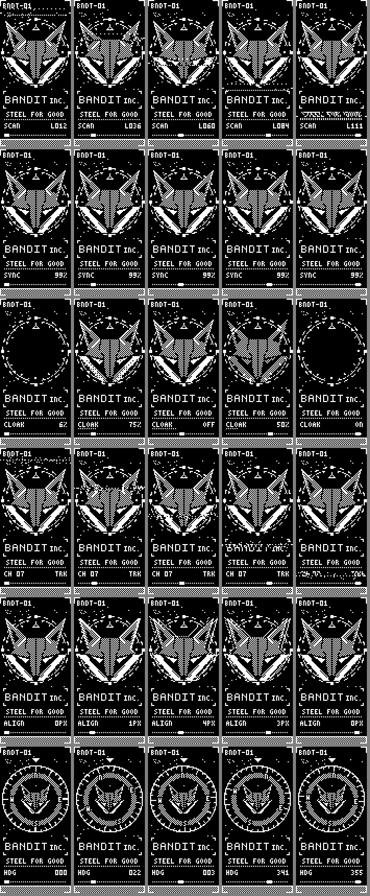

# Bandit Motion: right-screen art set

Six bundled right-screen pieces that add movement and distortion styles to the Bandit emblem
(the fox in the HUD ring, "BANDIT INC.", "STEEL FOR GOOD"). They extend the library. Nothing
existing changes: `Bandit_Emblem` stays the firmware's one built-in, and the first Bandit scenes
stay as they are. The pieces ship in `app/resources/art/bandit-motion/` and appear on the
Screens page as bundled sets (`art_pieces::BUNDLED`). They are pushed or kept like any library
piece.



| piece | what moves | frames | fps | size |
|---|---|---|---|---|
| `bandit-scanline.bin` | a slow CRT beam walks down the emblem; the rows under it bulge 2 px, a dotted beam leads and side pointers track it | 34 | 5 | 9.5 KiB |
| `bandit-glitch.bin` | thin slices (1 to 4 rows) slip sideways every 2 s or so, with a small torn block; SYNC dips while they show | 32 | 4 | 4.7 KiB |
| `bandit-cloak.bin` | the fox decloaks top-down behind a dithered edge, holds, then fades out through an ordered dither, 1/16 at a time | 48 | 4 | 7.6 KiB |
| `bandit-drift.bin` | a 7-row band of weak signal drifts down: rows lean 2 px, with sparse static and a dotted carrier line | 38 | 4 | 9.7 KiB |
| `bandit-ghost.bin` | "chromatic" misregistration in 1-bit: a solid and a dotted outline ghost of the fox slide up to 4 px apart and back | 24 | 4 | 4.1 KiB |
| `bandit-compass.bin` | a compass bezel with N/E/S/W and degree ticks swings around a smaller fox; HDG readout | 32 | 4 | 11.1 KiB |

## Rules they follow

- **Photosensitivity:** no flashing and no inversions. Between any two frames (the loop's wrap
  included), at most 3.5% of the screen changes and no 8x8 block flips by half. Row shifts are
  even, so the 50% checker never swaps phase. Large changes (cloak) happen gradually, over 4 s.
  `art-src/bandit/motion/check.py` measures this.
- **Size:** each set stays under 12 KiB, inside the 16 KiB push limit
  (`CONFIG_NICE_VIEW_ART_RELAY_MAX_SIZE`). `bundled_sets_fit_the_push_budget` checks every
  bundled set.
- The house style is three tones (solid, 50% checker, solid), dust specks in the empty corners
  and a checker floor.

## Rebuilding

The generator lives with the owner's art sources, not in this repo:

```
cd art-src/bandit/motion
python -I bandit_motion.py out
python -I check.py out
cd <foxglove>
python -I scripts/flipper_art.py app/resources/art/bandit-motion/bandit-NAME.bin ^
  ../art-src/bandit/motion/out/Bandit_NAME:polarity=as-is:label=Bandit NAME
```

The frames are saved lit = black (as in the first library), so `polarity=as-is` is right.
