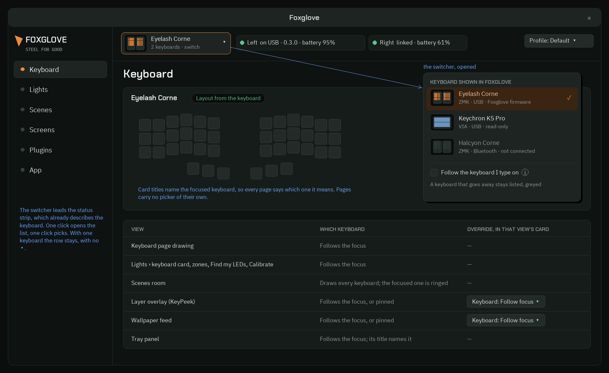
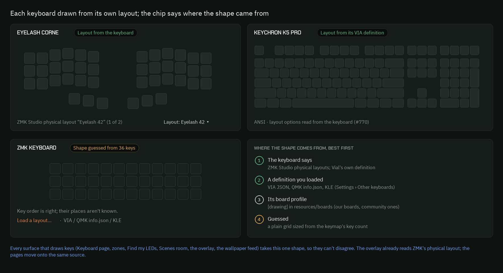
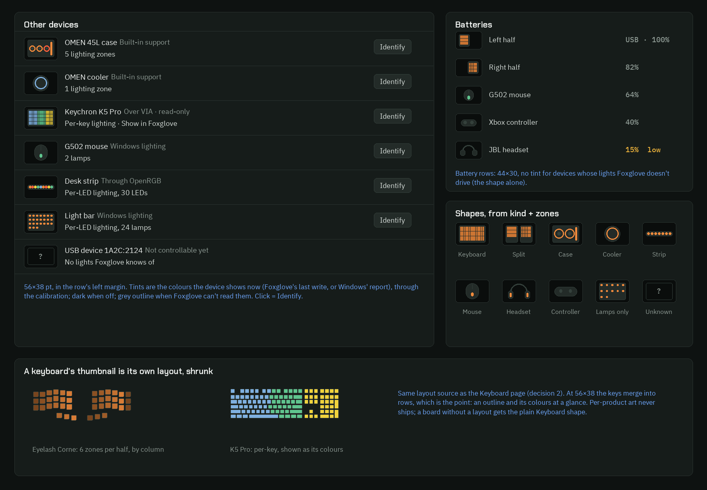
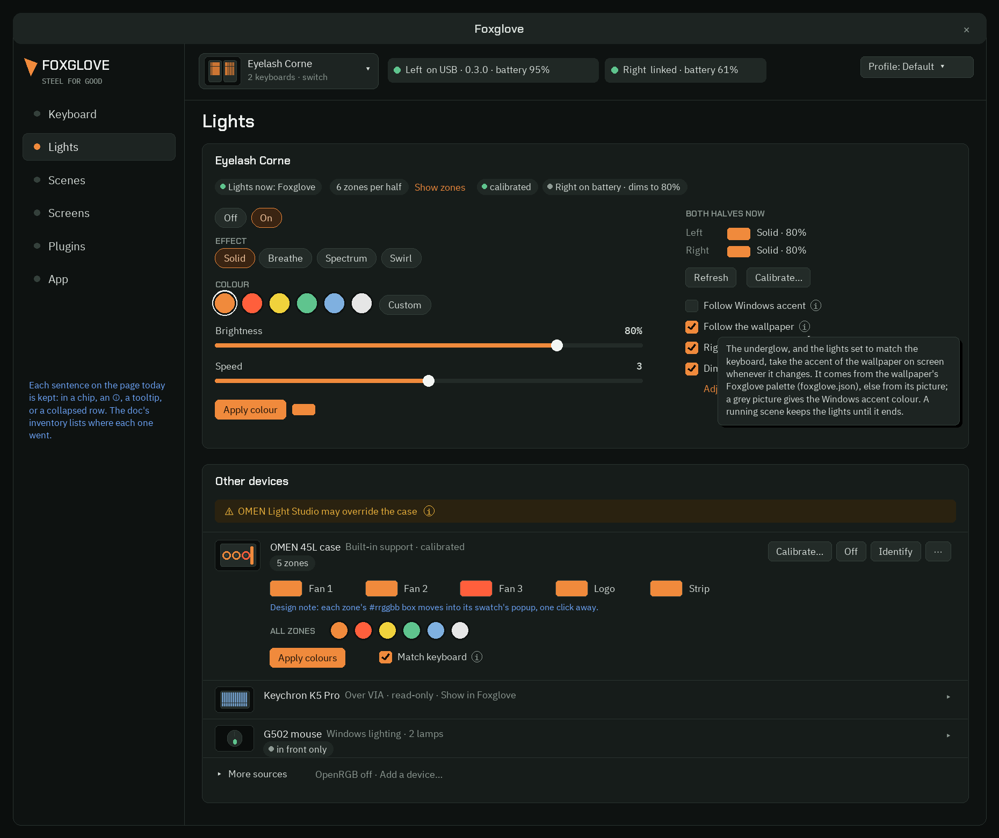
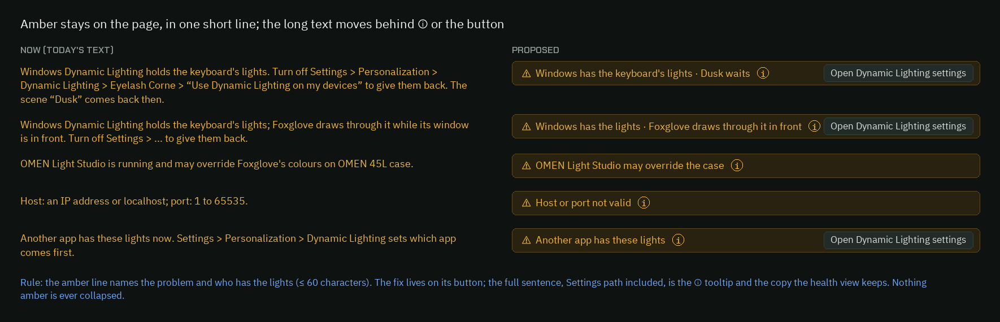

# Device focus, real key layouts, device thumbnails, and a quieter Lights page

Design only (ux-1105, 2026-11-05). **Approved by the user on 2026-11-05** ("i like that a lot"),
with two fixes now folded in: status chips are flat, and the EFFECT label sits above its pills.
Nothing here is built yet. Issues #793–#804 are filed; the plan below links each one.

## Decisions (2026-11-05, all option a)

1. **Focus:** one global switcher in the status strip. The overlay and the wallpaper feed can
   pin their own keyboard.
2. **Other devices rows:** collapsed by default.
3. **Hidden detail:** an ⓘ on controls (and on amber info bars); chips, labels and card titles
   carry their text on hover, with no ⓘ.
4. **"Follow the keyboard I type on":** later (C4), off by default.
5. A read-only VIA or LampArray-only keyboard that has the focus shows its lights in the
   keyboard card, with muted read-only chips, and isn't listed again under Other devices.
6. **No first-run highlight on the ⓘ icons.** The user declined it.
7. **Flat status chips** (user fix): see section 4, rule 2. This holds app-wide, not only on Lights.
8. **EFFECT label above the effect pills** (user fix), like COLOUR above the swatches: every
   control group's caps label sits on its own line above the group, never beside another row.

The user's request: "device 'focus' selection should be a thing for any integrated
representations of the keyboard. as well as key layout detection. and when it comes to the
devices page, it may be good to have a lowfi representation of the device and its coloration,
for quick reference. [...] i love the depth and sophistication of the lights page, but there is
a lot going on. i'm onboard for a declutter by simplifying written words into highlights or
tooltips if that makes sense. i dont want to lose any detail though, maybe just conceal it to
the casual viewer"

| # | Ask | Decision in one line |
|---|---|---|
| 1 | Device focus | One app-wide **focused keyboard**, picked from a switcher at the head of the status strip. Card titles name it. Only the overlay and the wallpaper feed can be pinned to another keyboard. |
| 2 | Key layout detection | One **layout source** per keyboard, best first: the keyboard says (ZMK Studio, Vial) > a loaded definition (VIA/QMK/KLE) > board profile > a guessed grid. A chip on the drawing says which one. |
| 3 | Device thumbnails | A 56×38 **low-fi drawing** on each device row, taken from the device's kind and zones and tinted with its current colours. A keyboard's thumbnail is its own layout, shrunk. No per-product art. |
| 4 | Lights declutter | **Nothing removed.** Long sentences move to an ⓘ tooltip, states become chips, device rows and rare sources collapse, and amber stays visible in one short line. Every sentence is listed in the inventory below. |

## Images

All PNGs are in `C:\Users\fuchs\splitkeeb\worktrees\_logs\review\ux-1105\`, with copies in
`C:\Users\fuchs\splitkeeb\review\` as `ux-focus-*`. The proposed ones are also in this PR, under
`docs/design/images/ux-1105/`.

- **Proposed** (Python + Pillow, `docs/design/mockups/ux_1105_mockups.py`, drawn in the theme's
  DARK palette and the app's fonts):
  - `ux-1105-proposed-1-focus.png`: the switcher, its list, and which views follow it
  - `ux-1105-proposed-2-layouts.png`: three keyboards from three layout sources, and the fallback ladder
  - `ux-1105-proposed-3-thumbs.png`: Other devices and the battery list with thumbnails, and the shapes they use
  - `ux-1105-proposed-4-lights.png`: the decluttered Lights page, with one tooltip open
  - `ux-1105-proposed-4b-amber.png`: each amber line now, next to its short form
- **Now** (real egui offscreen renders of `origin/main` cf7d6a90, `cargo test theme_preview` with
  `FOXGLOVE_UI_PREVIEW_DIR`):
  - `ux-1105-now-lights-page.png` (ui-423), `ux-1105-now-lights-windows-notice.png` (ui-749),
    `ux-1105-now-lights-windows-through.png`, `ux-1105-now-lights-zones-open.png` (ui-611),
    `ux-1105-now-lights-zones-devices.png`, `ux-1105-now-lights-battery-adjust.png`
  - `ux-1105-now-keyboard-page.png` (ui-386), `ux-1105-now-keyboard-page-full.png`,
    `ux-1105-now-batteries.png` (ui-505)

## Scope gate (docs/scope.md)

- **All four are in scope.** 1 to 3 are "the keyboard" and "device management on Windows: finding
  devices, their state, and one place to see them". 4 is a page we already ship.
- **No third-party app is needed.** VIA, QMK and KLE files are optional data the user loads.
- **Everything is event-driven.** The focus changes on a click or a connect/disconnect event. A
  layout is read when a keyboard connects (the Studio and Vial reads already happen then).
  Thumbnails repaint from the colours Foxglove already holds. "Follow the keyboard I type on" uses
  Raw Input device events, not polling.
- **Systems, not products.** The focus list includes any keyboard the device layer knows
  (host-link ZMK, VIA/Vial, a LampArray keyboard). Layouts come from standard formats.
  Thumbnails come from kind + zones. The Corne and the K5 Pro are only test devices.
- **Out of scope here:** VIA writes (#581 stays off), and per-product art (ruled out by the brief).

## Research (Reuse, then Emulate, then Design our own)

### Reuse (code we already have, and crates)
- **The keyboard's identity:** `devices::keyboard_key()`, `keyboard_id()`, `keyboard_name()`,
  `last_device.rs` (the remembered keyboard), and `via_host::found()` (VIA/Vial boards, read-only).
  Together these are enough to list keyboards. There is no "focus" concept yet: every page assumes
  `devices::device()`, the one host-link keyboard. Note that `focus.rs` already exists and is about
  *window* focus (#618), so the new module needs another name: `keyboard_focus.rs`.
- **Layouts:**
  - The overlay already draws ZMK Studio's physical layouts. `zmk_rpc` reads
    `get_physical_layouts`, `keymap_cache` caches them, and `keymap_layers.rs` switches between
    them, following ZMK Studio's `PhysicalLayoutPicker.tsx`.
  - The pages draw the board profile's `boards::Drawing` instead (`keyboard_page.rs:500`,
    `scene_room.rs:114`, `led_map.rs`, `light_zones.rs`, `health.rs`). That is the gap.
  - `crates/via::Definition` parses KLE rows into `foxglove_devices::Layout`
    (`Key { x, y, w, h, r }`) and follows layout options (#770). Vial boards hand over their own
    definition (#771).
  - `Drawing.keys` is already KLE-shaped (`[x, y, w]`).
  - Crate candidate for loading raw KLE/info.json files: `kle-serial` (check its licence against
    `deny.toml` before use). Or extend our own small KLE parser in `crates/via`, which is already
    written and tested. Recommended: extend ours.
- **Thumbnail shapes and tints:**
  - Windows hands us a LampArray's `LampArrayKind` (keyboard, mouse, game controller, peripheral,
    scene, chassis, headset, speaker...), its lamp `Position`s and its `BoundingBox`
    (`pc_lights.rs:1783`).
  - `scene_room::lamp_array_kind` already maps the kind to a room shape.
  - Catalog devices have a `DeviceKind` (case, cooler, strip, peripheral, other) and named zones.
  - `zones_ui` already draws zone geometry.
  - Bluetooth battery rows can take Windows' device category (mouse, headset, gamepad) from the
    same DeviceWatcher properties `peripherals.rs` reads.
- **Disclosure widgets:** egui already has `on_hover_text`, `CollapsingHeader` and
  `zones_ui::toggle`. The page already uses them, inconsistently.

### Emulate (patterns in shipping software)
- **Focus:**
  - Logitech G HUB: the device carousel at the top, where every page acts on the selected device.
  - Razer Synapse 3: one tab per device.
  - Corsair iCUE 5: a device list leads into one device's pages.
  - VIA and Vial: a device dropdown in the header when more than one board is plugged in.
  - Windows 11 Settings > Personalization > Dynamic Lighting: device cards across the top, and
    the page below shows the selected one.

  **Pick: G HUB/VIA's single header switcher.** Tabs (Synapse) don't scale past three devices.
  iCUE's drill-down adds a level the app doesn't have.
- **Layout:** VIA/Vial and QMK Configurator draw from KLE/info.json, ZMK Studio from the
  firmware's physical layout. All three show *the keyboard's own* shape. None of them invents one,
  except QMK Configurator, which grids an unknown board. **Pick: the same ladder, with a visible
  source chip**, as SignalRGB marks a "generic layout".
- **Thumbnails:**
  - Windows Settings > Bluetooth & devices: a glyph per device class.
  - Windows Dynamic Lighting: a device image with a live colour preview.
  - iCUE and SignalRGB: device tiles tinted with live lighting, and a generic shape for unknown
    gear.
  - OpenRGB: a LED grid view.

  **Pick: Windows' class glyph + iCUE's live tint**, drawn from data.
- **Declutter:**
  - Windows 11 Settings (WinUI `SettingsCard`): a header plus one short description, an
    `InfoBadge` / ⓘ for more, a `SettingsExpander` collapsed by default, and an `InfoBar` for
    warnings (short title + action button + more on demand).
  - macOS System Settings: an ⓘ button per row for detail sheets.
  - GitHub Primer: "progressive disclosure", where the full text stays one interaction away.

  **Pick: WinUI's vocabulary.** The app is Windows-first and the user knows these idioms.

### Design our own
Only the glue: the focus model (which views follow, which can pin), the source chip wording, the
thumbnail shape table, and the sentence inventory.

---

## 1. Device focus

**Where it lives:** the first item in the status strip (the bar that already says "Left on USB
· ... · Right ..."). The strip already describes one keyboard, so the switcher says *which* one.
It shows a thumbnail (decision 3), the keyboard's name, a muted second line ("2 keyboards ·
switch"), and ▾.
- One click opens the list, one click picks (one action per step).
- With one keyboard the row stays, without the ▾ or the second line, so a new user isn't shown a
  choice they can't make.

**The list ("Keyboard shown in Foxglove"):** one row per keyboard the device layer knows, each
with a thumbnail, its name, and "protocol · link · what Foxglove can do". For example:
- "ZMK · USB · Foxglove firmware"
- "VIA · USB · read-only"
- "ZMK · Bluetooth · not connected"

A keyboard that disconnects stays listed, greyed, until the app restarts. That way a replug
doesn't reorder the list. Below the rows: "Follow the keyboard I type on" (off by default, ⓘ:
"Shows the keyboard you last typed on. Off: your pick stays until you change it.").

**What follows the focus:**

| View | Which keyboard | Override |
|---|---|---|
| Keyboard page drawing, firmware and actions cards | Focus | none |
| Lights › keyboard card, zones, Find my LEDs, Calibrate | Focus | none |
| Scenes room | Draws every keyboard; the focused one is ringed | none |
| Layer overlay (KeyPeek) | Focus | "Keyboard: Follow focus ▾" in its card (Screens/App) |
| Wallpaper feed (live_feed, wallpaper_sync) | Focus | "Keyboard: Follow focus ▾" in its card |
| Tray panel | Focus; its title names it | none |

**Why one focus with two pins, not a picker per view:**
- The user asked for focus "for any integrated representations of the keyboard". One pick that
  every view honours is the smallest model that does that.
- Per-view pickers would put six dropdowns on the app, and views could disagree.
- The overlay and the feed are the exception: they run with the window closed, and a user may
  want KeyPeek on the Corne while editing the K5 Pro.

**Rules:**
- Card titles say the focused keyboard's name ("Eyelash Corne", not "Keyboard"), so every page
  says which keyboard it means.
- Remembered in `settings.ini [focus] keyboard = <device key>`.
- On start the focus is the remembered keyboard if it connects. Otherwise it is the host-link
  keyboard, otherwise the first one found.
- A newly connected keyboard never steals the focus, except when nothing was focused.
- **A keyboard with fewer capabilities** (VIA read-only, or a LampArray-only keyboard) gets the
  same pages with what it can do. Its controls go muted with a short reason chip ("read-only over
  VIA" plus an ⓘ explaining #581), never a blank page.
- A keyboard that isn't the focus is listed under Other devices with its thumbnail and a "Show in
  Foxglove" link that makes it the focus. It isn't listed twice.

## 2. Key layout detection

**One layout per keyboard**, a `KeyLayout { keys: Vec<Key>, source: LayoutSource, name,
choices }` in key units with rotation. Every surface that draws keys uses it: the Keyboard page,
zones, Find my LEDs, the LED-map confirm, the Scenes room, health, the overlay and the feed. They
can no longer disagree.

**The source, best first:**
1. **The keyboard says**: ZMK Studio's physical layouts (the active one, and the others as
   choices), or Vial's own definition with its layout options. Chip: "Layout from the keyboard"
   (green dot).
2. **A definition you loaded**: VIA JSON (already loadable in Settings › Other keyboards), and
   later QMK `info.json` or a raw KLE file. Chip: "Layout from its VIA definition" (green dot).
3. **Its board profile**: `[drawing]` in `resources/boards` or the user's boards folder. Chip:
   "Layout from Foxglove's board profile" (no dot).
4. **Guessed**: today's `Drawing::plain(keymap key count)`. Chip: "Shape guessed from N keys"
   (amber dot; flat like every status chip, and not an amber bar: it isn't a fault). Muted line: "Key order is right; their
   places aren't known." Link: "Load a layout…".

**Rules:**
- Several ZMK physical layouts, or VIA layout options: a small "Layout: <name> ▾" under the
  drawing. It is the same list the keymap editor's Layers prompt offers, so it is one control in
  two places.
- A split board's halves come from the layout itself (ZMK physical layouts place both halves). The
  profile's mirror rule is only used for the profile source.
- Rotation (`r`) is drawn. The Corne's thumb cluster and the Toucan have it.
- The ZMK matrix-to-LED map, the zones and the LED map keep their key indices. The layout only
  changes where the keys are drawn, so #611 and the LED map data stay valid. Where a profile's
  drawing and the keyboard's layout disagree in key count, the keyboard wins and the zone line
  says "zones from the profile may not match this layout" (muted, ⓘ).

## 3. Device thumbnails

**Where:**
- Every Other devices row: 56×38 pt in the row's left margin.
- The battery list (Keyboard page): 44×30.
- The focus switcher and its list.

**Shapes**, picked from data in this order: catalog `shape` (a new optional field), then
`LampArrayKind`, then catalog `DeviceKind`, then Bluetooth category, then "unknown".

| Shape | From | Drawn as |
|---|---|---|
| Keyboard | a keyboard (any source) | its own `KeyLayout`, shrunk (decision 2), with zone tints |
| Split | a keyboard with two parts | both halves, as in its layout |
| Case | catalog `case` / LampArray `Chassis` | an outline with one ring per fan zone and a bar per strip zone |
| Cooler | catalog `cooler` | one ring |
| Strip | catalog `strip` / LampArray `Scene` in a row | a bar with a dot per LED (at most 12, sampled) |
| Mouse, headset, controller | LampArray kind / Bluetooth category | a glyph with a tint dot per lamp (lamp positions when Windows gives them) |
| Lamps only | any LampArray with positions but no better kind | a dot per lamp at its position, inside its bounding box |
| Unknown | none of the above | a dashed outline with "?" |

**Tints** are the colours the device shows now: Foxglove's last write, or Windows' lamp colours
for a LampArray it drives, drawn through the device's calibration (`calibrate::on_screen`).
- Dark when off.
- Grey outline, no tint, when Foxglove can't read or drive its lights. Battery-only rows are an
  example.
- A rainbow effect animates only while its row is on screen and the window is in front, from the
  same frame clock the effect already uses. No new timer.

**Click:** Identify, when the device is driven. Hover: "Identify: blink this device for a moment".
No per-product art ships, and a board without a layout gets the plain Keyboard shape.

## 4. Lights page declutter

**The rules (WinUI's vocabulary):**
1. **At most one visible muted line per card.** The rest becomes chips, an ⓘ, a tooltip, or a
   collapsed expander.
2. **State becomes a chip, explanation becomes a tooltip.** A chip is 1 to 4 words, the state
   only: "6 zones per half", "calibrated", "in front only". The sentence that explains it is the
   chip's hover text, word for word. Nothing is reworded away.
   **Status chips are flat** (app-wide rule): a read-only chip has **no outline**, a muted fill
   (`CHIP_FILL`, between `surface` and `control`) and, when its state has a colour, a **leading
   dot** in it (ok green, muted grey, warn amber). The text stays `text`, not coloured.
   **Outlines are only for clickable things:** pills, buttons, dropdowns, text fields. The same
   goes for the status strip's part chips and for amber info bars (fill only). A link is accent
   text, never a chip.
3. **ⓘ only on controls** (a checkbox, a button) **and on amber info bars.** Hovering the
   control's label shows the same text, so the ⓘ is a hint that there is more, not a second place
   for it. Chips, plain labels and card titles carry their hover text directly, with no ⓘ. There
   is no first-run highlight on the ⓘ.
4. **Caps labels sit above their group,** never to the side: OFF/ON, then EFFECT over the effect
   pills, then COLOUR over the swatches.
5. **Amber is never collapsed.** It becomes one InfoBar line of 60 characters or less that names
   the problem, plus its action button. The full sentence, Settings path included, goes in the
   InfoBar's ⓘ, and the health view keeps the long copy.
6. **Expanders are collapsed by default, and remembered for the session** (as Show zones is now):
   each device row, "More sources" (OpenRGB, Add a device), "Adjust levels…".
7. **The casual viewer sees state and controls:** who drives the lights, the effect, the colour,
   brightness, and each device's thumbnail and name. Everything else is one hover or one click
   away.
8. **A result shows next to what was clicked, and its tone sets how long it stays** (A3b,
   2026-11-05). A confirmation is a flat chip with a green dot on that row (closed rows too)
   and fades after 5 s, the art strip's pace. A note (nothing changed, and why) is a muted info
   bar under the row. A problem is an amber info bar under the row. Both stay until the next
   result for that same place: each place keeps its own, so one row's result never replaces
   another's. "Match keyboard" following the keyboard on its own shows only what went wrong,
   never a green chip nobody clicked for. There are no toasts for in-window actions: Windows
   notifications stay for events that happen while the window is closed. A card-wide result
   (your own catalog file that can't be saved) goes to the card's top, Add a device's on More
   sources, and the keyboard card's own on the keyboard card. A refusal while paused goes
   where it was clicked. The full text is the hover or the ⓘ.

### Sentence inventory: where each one goes

Sources: `lights_page.rs`, `lights_owner.rs`, `light_zones.rs`, `zones_ui.rs`,
`battery_dim_ui.rs`, `led_map_ui.rs` (entry), `effect_controls.rs`, `pc_lights_ui.rs`,
`pc_lights_add.rs`, `calibrate_ui.rs` (not matched), checked against the "now" renders.
- **Visible**: on the page, as now or shortened as shown. The original stays as hover text.
- **Chip**: a short highlight, with the original as its hover text.
- **Tooltip**: hover text only. Already a tooltip unless marked *(moved)*.
- **Expander**: inside a collapsed section.

**Keyboard card** (its title becomes the focused keyboard's name)

| # | Text now | Goes to |
|---|---|---|
| K1 | "Lights now: {who}" (+ TIP on hover: "Who drives the keyboard's lights… lets go.") | Chip "Lights now: Foxglove" (green dot); hover = TIP |
| K2 | "Windows Dynamic Lighting holds the keyboard's lights. Turn off Settings > Personalization > Dynamic Lighting > {device} > "Use Dynamic Lighting on my devices" to give them back. [The scene "{name}" comes back then.]" | Amber InfoBar "Windows has the keyboard's lights · {scene} waits" + button "Open Dynamic Lighting settings" (unchanged) + ⓘ with the full sentence *(moved)* |
| K3 | "Windows Dynamic Lighting holds the keyboard's lights; Foxglove draws through it [while its window is in front]. Turn off … to give them back." | Amber InfoBar "Windows has the lights · Foxglove draws through it [in front]" + button + ⓘ full *(moved)* |
| K4 | Zone summary "6 lighting zones per half, by column" (+ details on hover) | Chip "6 zones per half"; hover = the summary + details *(moved)*; "Show zones" link stays beside it |
| K5 | "Lighting zones unknown" + "Check zones…" (hint: "Light one lamp at a time and click the keys it lights" / "Needs keyboard firmware that lights one lamp at a time, and a board profile") | Chip "Zones unknown" + link "Check zones…" (hints unchanged) |
| K6 | "The keyboard reports {n} lamps; which keys each one lights isn't known yet." (hover) | Tooltip of the K5 chip |
| K7 | Zone drawing: source line ("From your check" / "From the board's profile · not checked on yours yet" / "Reported by the device" …) | Expander (Show zones), as now; the source becomes a chip in the drawing's header |
| K8 | Zone drawing: "{n} more lamps … light nothing; Foxglove leaves them out." | Expander, visible muted line under the drawing (it is state) |
| K9 | Zone drawing: ZONE_LOOKS "Per-key looks (scenes, ripples) take one colour per zone here: the colour at the zone's centre." | Expander, hover on the drawing's title *(moved)* |
| K10 | "Not right?" + "Check zones…" + "Forget my check" (hint: "Go back to the board's profile, or what the keyboard reports") | Expander, as now |
| K11 | Effect pill hover "Swirl (rainbow; colour not used yet)" | Tooltip, as now |
| K12 | "The keyboard shows {X}; Foxglove saved {Y}. Pick {an effect / an effect or a colour} to change it." | Chip "Saved: {Y}" beside the effect pills + hover = the sentence *(moved)* |
| K13 | "Waiting for the keyboard's colour…" | Visible (transient state) |
| K14 | "{name} is a rainbow: it doesn't use the colour yet. Brightness and speed still apply." | Caption "Looks like" stays; the sentence is the rainbow band's hover *(moved)* |
| K15 | "{name} moves a band of hues around this colour, {30}° either way." | Chip "±30°" at the band's end + hover = the sentence *(moved)* |
| K16 | Labels "Effect", "Colour"/"Looks like", "Brightness", "Speed", values | Visible |
| K17 | "Apply colour" / "Apply brightness" + preview swatch | Visible |
| K18 | "Follow the Windows accent colour" + hover "The underglow takes the accent colour's hue … The brightness stays the board's." | Checkbox "Follow Windows accent" + ⓘ; hover unchanged, starting "Follow the Windows accent colour:" so the full label survives |
| K19 | "Lights follow the wallpaper" + hover "The underglow, and the lights set to match … A running scene keeps the lights until it ends." | Checkbox "Follow the wallpaper" + ⓘ; hover unchanged |
| K20 | "The controls need an RGB key (&rgb_ug) somewhere in the keymap." | Visible, shortened: "Needs an RGB key in the keymap" + ⓘ with the full sentence (the `&rgb_ug` name lives only in the tooltip) |
| K21 | "{Both halves} now" + per part "on · Solid · 80% · speed 3" / "off" / "no data yet" / "· {n} s ago" | Visible "Solid · 80%" / "off" / "no data yet"; the full line on hover; "· {n} s ago" stays visible (staleness is state) |
| K22 | "Refresh" (hover "Ask {both halves} for their lights again") | Visible, as now |
| K23 | "Calibrate…" (hover "Match how the keyboard shows colours … about a minute") + "calibrated" | Button as now; "calibrated" becomes a chip in the header row |
| K24 | "{Right half}'s lights follow the {left}" + hover follow_tip ("On: … Saved on the keyboard.") | Checkbox "Right follows left" + ⓘ; hover starts with the full label, then the tip |
| K25 | "Asking the keyboard…" / "{label}: needs a keyboard with Foxglove's firmware" / "{label}: needs newer keyboard firmware" + ↻ | Disabled checkbox + muted chip "needs newer firmware" / "needs Foxglove firmware"; the full line is the hover; ↻ stays |
| K26 | "Save battery: dim lights on battery" + hover "Each half dims its own lights … works without Foxglove." | Checkbox "Dim on battery" + ⓘ; hover starts with the full label |
| K27 | Status lines "Right half on battery · 80%", "Left half on USB · 100%" | Header chip "Right on battery · dims to 80%" (grey dot; the part being dimmed); both lines on its hover *(moved)* |
| K28 | "Off: your brightness on battery too." | Hover of the unchecked "Dim on battery" *(moved)* |
| K29 | "{The right half} takes these levels when it next connects." | Visible muted line under the checkbox (pending state) |
| K30 | "Adjust…" / "Hide levels" (hover "The brightness on power, on battery and on low battery"), rows "On power" / "On battery" / "Low battery" / "Low battery threshold" + hints, "Defaults" (hover "100% on power, 80% on battery, 12% below 20% charge") | "Adjust levels…" expander, collapsed, contents unchanged |
| K31 | "Save battery: asking the keyboard…" / "…: needs a keyboard with Foxglove's firmware" / "…: needs newer keyboard firmware" / "…: the keyboard didn't answer" + ↻ | As K25: disabled checkbox + short chip + hover |
| K32 | LED map entry (no zones line): "Check zones…" + hints; "LED map: checked" / "LED map: shipped, not checked yet" / "LED positions: not placed yet" | Header chip with the state; "Check zones…" link beside it; hints unchanged |

**Other devices card**

| # | Text now | Goes to |
|---|---|---|
| O1 | "Case lights, screens and other lighting devices on this PC, and what each can do." | Hover on the card title *(moved)* |
| O2 | "{app} is running and may override Foxglove's colours on {device}." (+ hint on hover) | Amber InfoBar "{app} may override the {device}" + ⓘ with the sentence and the hint |
| O3 | "No PC or peripheral lights found." | Visible (empty state) |
| O4 | Row header: name, "Built-in support" / "Windows lighting" / "Not controllable yet" / "Through OpenRGB", "· added by you", "· calibrated" | Visible, one muted line, beside the new thumbnail |
| O5 | Light summary "5 lighting zones" / "Per-LED lighting, 24 lamps" / "On/off light" / "1 zone (whole device)" (+ TIP "How finely Foxglove can set this device's colours. Effects use one colour per zone.") | Chip "5 zones" in the collapsed row, hover = TIP; full summary in the expanded row |
| O6 | Screen chips ("Screen · images & animations"), "No lights Foxglove knows of" | Chips, as now |
| O7 | "Show zones" / "Hide zones" | Inside the expanded row, as now |
| O8 | "Calibrate…" (hover), "Off" (hover "Turn every zone dark"), "Identify" (hover "Blink this device …") | Identify stays on the collapsed row (also on the thumbnail); Calibrate… and Off in the expanded row; hovers unchanged |
| O9 | "Turned off in Windows' Dynamic Lighting settings." | Chip "off in Windows" (amber dot) + hover = the sentence *(moved)* |
| O10 | "Another app has these lights now. Settings > Personalization > Dynamic Lighting sets which app comes first." | Chip "another app has it" (amber dot) + button "Open Dynamic Lighting settings" (new, the same one as K2) + hover = the sentence |
| O11 | "Windows shows Foxglove's colours here while Foxglove's window is in front." / "…; in the background its own Dynamic Lighting takes over." | Chip "in front only" (grey dot), hover = the sentence *(moved)* |
| O12 | "Windows lighting: reading its lamps from Windows." | Chip "reading lamps…" (grey dot) + hover *(moved)* |
| O13 | "Windows lists no Dynamic Lighting device for it right now." | Chip "not in Windows right now" (grey dot) + hover *(moved)* |
| O14 | "Found, not controllable yet." | Merged into O4's "Not controllable yet" (same words); the sentence is its hover |
| O15 | Zone pickers: hover "{zone}: pick a colour, then Apply", "not set", "changed", zone names | Expanded row, as now |
| O16 | Hex box "#rrggbb" (hover "{zone}: type a colour as #rrggbb, then Apply") | Expanded row, inside each zone's swatch popup (one click), so the row loses a line of boxes |
| O17 | "not matched yet" (hover "None of this light's matches is near this colour: click to add a match for it") | Expanded row, as now |
| O18 | "Colour" / "All zones" / "All lamps" / "All LEDs" + swatches | Expanded row, as now |
| O19 | "Apply colours" | Expanded row, as now |
| O20 | "Match keyboard" + hover "Show the colour the keyboard's lights show … Picking a colour here stops it." | Checkbox + ⓘ; hover unchanged |
| O21 | "Forget your entry for this device?" + Remove / Keep | Visible (amber, transient), as now |
| O22 | "More ▸" (hover "Copy entry, Remove"), "Copy entry" (hover "Copy this device's catalog entry (TOML) …"), "Remove…" (hover "Forget your entry for this device") | "⋯" menu on the row, contents unchanged |
| O23 | "Use OpenRGB's devices" + hover "List the devices a running OpenRGB drives … Turn on OpenRGB's SDK server first." | "More sources" expander (collapsed); its header summary says "OpenRGB off" / "OpenRGB: 4 devices"; a chip "OpenRGB not connected" (amber dot) in the header while it is on and down (amber stays visible) |
| O24 | "Off: Foxglove doesn't connect to OpenRGB." | Hover of the unchecked checkbox *(moved)* |
| O25 | "Host", "Port" (hover "OpenRGB's address: an IP address, or localhost"), "Connect" (hover "Connect to OpenRGB at this address") | More sources, as now |
| O26 | "Host: an IP address or localhost; port: 1 to 65535." | More sources: amber "Host or port not valid" + ⓘ with the sentence |
| O27 | "Reconnect automatically" (hover "A few tries, a little longer apart each time, then Foxglove stops") | More sources, as now |
| O28 | OpenRGB status line (mono) | More sources, as now |
| O29 | "Add a device…" + "For lighting gear Foxglove doesn't recognise yet." | More sources: the button; the sentence becomes its hover *(moved)* |
| O30 | Add-a-device wizard (all its lines: "Add a device: which one?", "Every HID device on this PC is recognised already.", "Name the zones: zone {id} ({i} of {n})", "Light zone {id}", "What lit up?", "Foxglove will list it and remember its name, but can't light it.", "Saved to {file}. Copy entry shares it later.", "Pick a device first", "Give it a name", "Name at least one zone, or choose Unknown", buttons) | Unchanged: it is a flow, opened on purpose |
| O31 | Worker status line (mono, muted) | Next to what was clicked (rule 8, A3b): a fading chip on the row, or a bar under it that stays; the full line on hover or the ⓘ |

Count: 32 keyboard-card items and 31 Other-devices items. Zero are removed. 17 change place
(*moved*), and every amber item stays on screen.

---

## Phased PR plan

Small PRs, one per issue, each with its own offscreen previews (`theme_preview`) as the review
images. A–D can run two at a time: A doesn't touch B or C. Taste checks are batched per phase,
not per PR.

**Phase A: declutter (no new data, ships the user's ask first)**
1. **A1 (#793) · Disclosure widgets.** `theme::hint_chip(text, hover)`, `theme::info_dot(hover)`,
   `theme::info_bar(level, short, full, action)`, and `settings_ui::expander(key, header,
   summary)` with session-remembered open state (generalising `zones_ui::toggle`).
   - *AC:* a preview sheet of each widget, dark and light. `hint_chip` has no outline, a muted
     fill and an optional leading dot (the flat-chip rule); a source test keeps strokes off it.
     The ⓘ hover equals the given text. No first-run highlight. `info_bar` is fill only and
     never collapses. Keyboard focus reaches the ⓘ, and Enter/Space shows its text (for
     keyboard users). No page changes yet.
2. **A2 (#794) · Keyboard card declutter** (K1–K32).
   - *AC:* each K row behaves as the inventory says. EFFECT sits above the effect pills, like
     COLOUR. A test asserts every K-row string still
     renders somewhere: visible, or as hover text found through egui's `WidgetInfo`/tooltips in a
     headless frame. Previews `ui-1105-lights-keyboard{,-windows,-through,-unknown-zones,-old-firmware}.png`.
     The card is shorter than today's at 980 pt (measured in the preview). Amber is still visible
     in the Windows states.
3. **A3 (#795) · Other devices declutter** (O1–O31).
   - *AC:* device rows are collapsible, collapsed by default, and remembered for the session.
     "More sources" holds OpenRGB and Add a device, and its header summary shows OpenRGB's state
     (amber when on and down). The hex box lives in the zone popup. The same "every string still
     reachable" test covers the O rows. Previews with 1, 3 and 7 devices, plus a conflict.

**Phase B: one layout source**
4. **B1 (#796) · `KeyLayout` and its source ladder.** Steps 1, 3 and 4 of the ladder (ZMK Studio
   physical layout, profile, guessed), with rotation. The Keyboard page, zones, LED map, Scenes
   room and health take it instead of `boards::drawing`. The source chip goes on the Keyboard
   page drawing.
   - *AC:* with a cached Studio layout the drawing matches the overlay's key rectangles (test).
     Without one, the profile's drawing as today (snapshot unchanged). The zone and LED-map key
     indices are unchanged (existing #611/LED-map tests green). A Corne preview with rotated
     thumbs.
5. **B2 (#797) · VIA/Vial keyboards drawn.** Step 2 of the ladder from `crates/via::Definition::layout_for(options)`,
   for a VIA/Vial keyboard (drawing only, no keymap writes).
   - *AC:* a K5 Pro definition fixture renders the full-size layout and follows a layout-options
     value (test from #770's fixtures). The chip reads "Layout from its VIA definition".
6. **B3 (#798) · "Load a layout…".** For a guessed board, import VIA JSON / QMK `info.json` / KLE into
   the user's boards folder as a profile `[drawing]`. It is data, so it survives updates.
   - *AC:* the file dialog accepts only those formats. A bad file says why in one line. Bounded
     size (the 0.2 VIA definition limits). The imported layout wins over the guess on the next
     connect, without a restart.

**Phase C: focus**
7. **C1 (#799) · Focus model (no UI).** `keyboard_focus.rs` holds the keyboards the device layer knows
   (host-link, VIA/Vial, LampArray keyboards), the pick, `[focus]` persistence and the start
   rules. It sends an event on change. Pages read `keyboard_focus::current()`. With one keyboard
   nothing changes.
   - *AC:* unit tests for the start rule, a replug keeping the pick, a new keyboard not stealing
     it, and a gone keyboard greyed. No polling (it is driven by device-watch events). The local
     API gets `focus.get` / `focus.set` (and a plugin-api schema bump if needed).
8. **C2 (#800) · Switcher and pages.** The strip's switcher and its list. Card titles take the focused
   keyboard's name. The Keyboard page, Lights card, zones, Find my LEDs and Calibrate follow the
   focus. A read-only keyboard's controls are muted with a reason chip. Other devices lists the
   non-focused keyboards with "Show in Foxglove".
   - *AC:* previews of one keyboard (no ▾), two keyboards, the list open, and the K5 Pro focused
     (read-only chips). Every action is one click. Switching repaints from cached state with no
     device read on the UI thread.
9. **C3 (#801) · Overlay, feed, tray.** The overlay and the wallpaper feed follow the focus by default,
   each with "Keyboard: Follow focus ▾" in its own card. The tray panel's title names the focus.
   The Scenes room draws every keyboard and rings the focused one.
   - *AC:* a pinned overlay keeps its keyboard while the focus changes (test). The feed's
     manifest output names the keyboard (docs/live-feed.md updated). Room previews with two
     keyboards.
10. **C4 (#802) · "Follow the keyboard I type on"** (optional, last). Raw Input (`RIDEV_INPUTSINK`,
    device handle only, never key codes stored) maps the last typing device to a known keyboard.
    It is off by default.
    - *AC:* the setting is off by default. Only the device handle is read, with no key contents
      logged or kept (a source test). It is event-driven. It switches at most once per second, so
      typing on two boards doesn't flicker.

**Phase D: thumbnails**
11. **D1 (#803) · `device_thumb` painter.** The shape table above, with tints through calibration, dark
    when off, grey when unknown, and the keyboard shape from `KeyLayout` (B1). Adds the optional
    catalog field `shape` (data, documented in docs/plugins-and-devices.md).
    - *AC:* a preview sheet of every shape, lit, off and unknown. The thumbnail of each
      `fixtures.rs` device. No per-product art in the repo (a source test: no device names in
      `device_thumb`).
12. **D2 (#804) · Thumbnails in place.** Other devices rows (click = Identify when driven), the battery
    list (from Bluetooth category), and the focus switcher.
    - *AC:* previews of ui-423 and ui-505 with thumbnails. A rainbow animates only while visible
      and in front (it reuses the effect frame clock, adds no timer). Identify through the
      thumbnail sends the same message as the button.

**Taste checks (batched):** one after phase A (#793–#795), one after D2 (C1, C2, D1, D2:
#799, #800, #803, #804).

**Order:** A1 → A2 → A3 (one batched taste check), in parallel with B1. Then C1 → C2 → D1 → D2
(the second taste check), then C3 → B2 → B3 → C4. B1 comes before D1, because keyboard
thumbnails are their layout. C2 can ship with a plain keyboard glyph until D1 lands.

## Issues (filed 2026-11-05, labels `ui` and `0.3`)

Each one follows the Feature template. Research and Scope are summarised from the sections above.

- **Lights: disclosure widgets (chip, ⓘ, info bar, expander)** (A1, #793). Research: WinUI
  SettingsCard / InfoBar / SettingsExpander, macOS ⓘ. Scope: in, a shipped page.
- **Lights: declutter the keyboard card, keeping every word** (A2, #794). Research: as A1. AC as above.
- **Lights: declutter Other devices; collapsible rows and More sources** (A3, #795).
- **One key layout per keyboard, from the keyboard first** (B1, #796). Research: reuse zmk_rpc
  physical layouts, `crates/via` KLE, `boards::Drawing`; emulate ZMK Studio, VIA, QMK
  Configurator. Scope: in, the keyboard.
- **Draw VIA/Vial keyboards from their definitions** (B2, #797). Depends on B1, #770, #771.
- **Load a layout for an unknown board (VIA, info.json, KLE)** (B3, #798). Research: `kle-serial`
  licence check vs our parser.
- **Keyboard focus: one focused keyboard across the app** (C1, #799). Research: G HUB, VIA, Windows
  Dynamic Lighting device cards. Scope: in, device management.
- **Keyboard switcher in the status strip; pages follow the focus** (C2, #800).
- **Overlay and wallpaper feed: follow the focus or pin a keyboard** (C3, #801).
- **Follow the keyboard I type on (Raw Input, opt-in)** (C4, #802). Scope note: device handles only,
  never key contents.
- **Low-fi device thumbnails from kind and zones** (D1, #803). Research: Windows device-class glyphs,
  iCUE/SignalRGB tinted tiles, LampArrayKind + lamp positions.
- **Thumbnails on device rows, the battery list and the switcher** (D2, #804).

## Open questions for the Hub (answered 2026-11-05: all a)

Kept for the record; the answers are in Decisions at the top.

1. **Where does the focus picker live?** (`C:\Users\fuchs\splitkeeb\worktrees\_logs\review\ux-1105\ux-1105-proposed-1-focus.png`)
   a) One global focus in the status strip's switcher; the overlay and feed can pin. *(recommended)*
   b) A picker in each view.
   c) A G HUB-style carousel on the Keyboard page only.
2. **Device rows in Other devices: collapsed by default?** (`...\ux-1105-proposed-4-lights.png`)
   a) Collapsed: thumbnail, name, summary, Identify. Expand for zones and colours. *(recommended)*
   b) Expanded as today, with only the words moved.
3. **Marking hidden detail:**
   a) An ⓘ on controls, plus hover on chips and labels. *(recommended)*
   b) Hover only, with no ⓘ marks. Cleaner, but harder to discover.
4. **"Follow the keyboard I type on":**
   a) Later (C4), off by default. *(recommended)*
   b) In C2, on by default.
   c) Never.

Not a decision, for the record: a LampArray-only or VIA keyboard that is the focus shows its
lights in the keyboard card (with muted read-only chips) and isn't repeated under Other devices.
