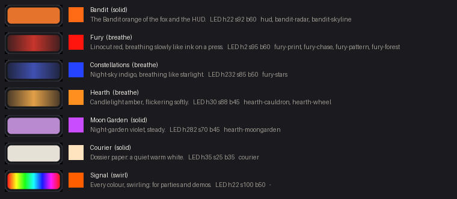

# Lighting presets

Curated underglow looks that match the Bandit wallpapers and screen art, for **Settings →
Lighting** and for profiles (M7). The data is `app/resources/lighting-presets.json`, with a
preview chip per preset in `app/resources/lighting/<id>.svg`. Both are written by
`scripts/lighting_presets.py` (`--sheet` renders the review sheet below; it needs `resvg-py`).



| id | name | colour (hue / sat / bright) | effect | matches |
|---|---|---|---|---|
| `bandit` | Bandit | 22 / 92 / 60, Bandit orange | solid | hud, bandit-radar, bandit-skyline |
| `fury` | Fury | 2 / 95 / 60, linocut red | breathe | fury-print, fury-chase, fury-pattern, fury-forest |
| `constellations` | Constellations | 232 / 85 / 50, night-sky indigo | breathe | fury-stars |
| `hearth` | Hearth | 30 / 88 / 45, candle amber | breathe | hearth-cauldron, hearth-wheel |
| `moon-garden` | Moon Garden | 282 / 70 / 45, violet | solid | hearth-moongarden |
| `courier` | Courier | 35 / 25 / 35, warm white | solid | courier |
| `signal` | Signal | rainbow | swirl | none |

## Format (`foxglove-lighting-presets` v1)

```json
{
  "format": "foxglove-lighting-presets", "version": 1,
  "effects": ["solid", "breathe", "spectrum", "swirl"],
  "presets": [
    { "id": "fury", "name": "Fury", "description": "Linocut red, breathing slowly like ink on a press.",
      "color": { "hue": 2, "saturation": 95, "brightness": 60 }, "effect": "breathe",
      "swatch": "#c8342b", "wallpapers": ["fury-print", "fury-chase", "fury-pattern", "fury-forest"] }
  ]
}
```

- **`id`:** stable. Profiles and settings store it. Change `name`, never `id`.
- **`color`:** the same HSB as `SetLightingParams`: hue 0-359, saturation and brightness 0-100.
  The battery cap (about 30% off USB) still applies on top. The values are tuned for the WS2812
  LEDs, where low saturation washes out to white, so they're stronger than the screen colours.
- **`effect`:** an entry from `effects`. Its index is the keyboard's effect number ("0" solid,
  "1" breathe, "2" spectrum, "3" swirl).
- **`swatch`:** the colour as it looks on screen, for a Settings chip drawn in code. The
  `.svg` chip (64x24) shows the effect too: solid fill, breathe fading at the ends, swirl as a
  rainbow.
- **`wallpapers`:** the [bandit-wallpapers](https://github.com/BanditF/bandit-wallpapers) ids this
  preset goes with (the `id`s in its `wallpapers.json`), for a later "lights follow the wallpaper"
  option.
- No speed yet: `SetLightingParams` has none. Add `"speed"` when the API does.

## Profiles

A profile picks a preset by id: `[profiles.Game] lighting = { preset = "fury" }`. Any explicit
`color` or `effect` in the same profile overrides the preset's value. An unknown id (say, a
preset removed in a later version) falls back to the base lighting settings.

## Credits

The presets and chips are drawn for Foxglove from the owner's wallpaper palettes. It's plain
data with no third-party content.
