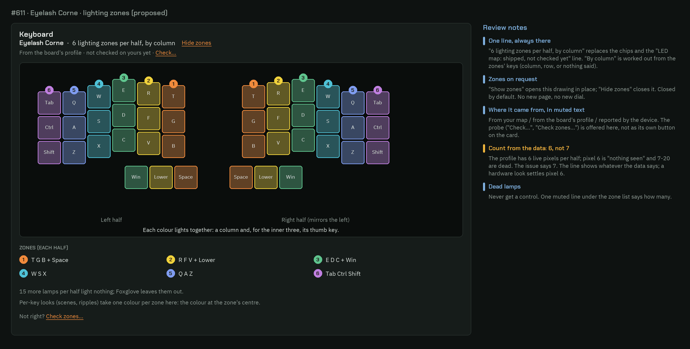
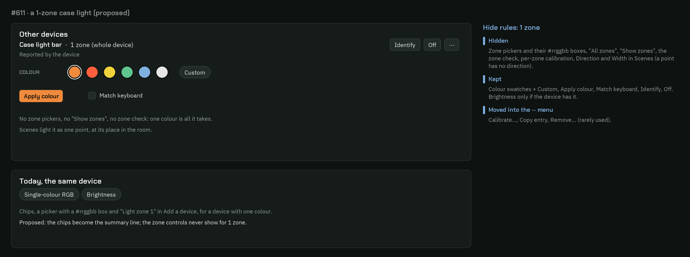
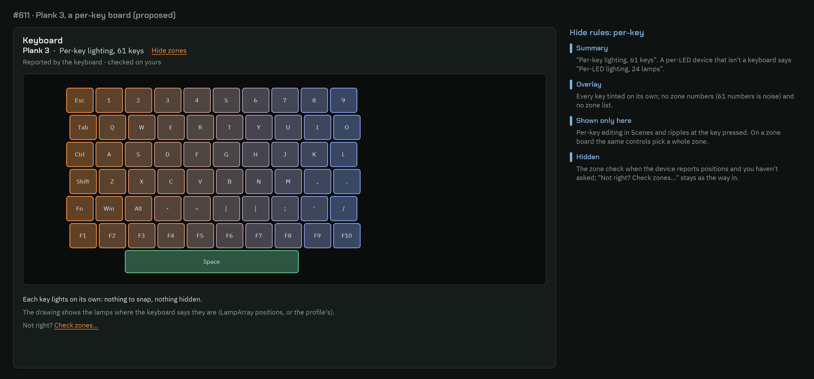
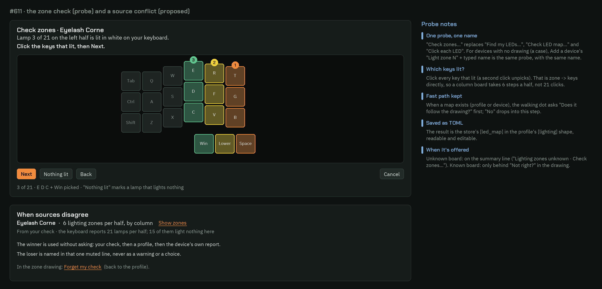
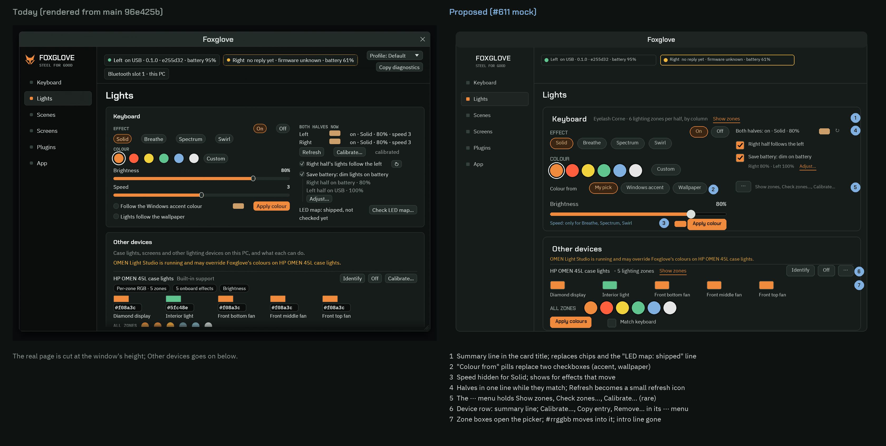

# Lighting zones: what each light can really do (UX design, #611)

Design only. It is the UX hand-off for #611. The app-engineer builds it, and the user's taste check
goes through #90. Mocks are in [images/lighting-zones/](images/lighting-zones/). The "today" half of
the before/after is rendered from main by `theme_preview::lights_page_renders`, and the other mocks
are drawn with Pillow.

**The brief, in the user's words:** "Is there a way we could detect things like this and show them to
the user? In a generic way? … I know we have lots of dials and settings." So the goal is to show each
device's real lighting resolution once, honestly, and to end up with **fewer visible controls** than
today, not more.

## Research and scope

- **Scope:** in. It covers the keyboard's and the PC's lights (docs/scope.md). It works for every
  device of its class, keeps quirks in data and needs no tuning on the user's PC.
- **Reuse:**
  - `LightCaps` in `crates/devices/src/pc_lighting/caps.rs` already exists, with `Color::{Single,
    PerZone, PerLed}` and a count. The chips on the Other devices card come from it. #611's record
    should extend this type: add the zone list, and treat `kind` as the existing `Color`. Don't add a
    second `LightCaps`.
  - Board profiles' `[lighting] led_keys` already holds groups and dead lamps (#608).
  - The store's `[led_map]` holds the user's own map.
  - The probes already exist: Check LED map (`led_map_confirm.rs`), Find my LEDs / Click each LED
    (`led_map_ui.rs`), and Add a device's "Light zone N" (`pc_lights_add.rs`).
- **Emulate:**
  - OpenRGB: device → zones → LEDs, and greyed modes. We hide instead of greying.
  - Windows Dynamic Lighting: one device card with its lamp picture, and effects it can't show are
    not offered.
  - SignalRGB / iCUE / Synapse: a per-key editor only for per-key devices and a zone picker for zone
    devices. Quirks live in per-device data files.
  - Philips Hue entertainment setup / Nanoleaf layout assistant: "this light is blinking: show us
    where". The probe already follows this.

## 1. The zone summary line

Every light device gets **one line** in the same place: after its name, in the device's row (for the
keyboard, in the Keyboard card's title row). It replaces the light chip ("Per-zone RGB · 5 zones")
and, for the keyboard, the "LED map: shipped, not checked yet" line.

| Device kind (`Color`) | Summary | "Show zones" link |
|---|---|---|
| `Single` | **1 zone (whole device)** | no |
| `PerZone`, keys known | **6 lighting zones per half, by column** | yes |
| `PerZone`, areas (case) | **5 lighting zones** | yes |
| `PerLed`, a keyboard | **Per-key lighting, 61 keys** | yes |
| `PerLed`, anything else | **Per-LED lighting, 24 lamps** | yes |
| `OnOff` | **On/off light** | no |
| Zones not known | **Lighting zones unknown** · **Check zones…** | no; the probe is offered here |

Rules:
- **"per half"** appears only when the halves mirror each other. Halves that differ get "6 + 7 lighting
  zones". A one-piece board never says "half" (as in #559).
- **"by column" / "by row"** is worked out from the zones' keys. If every zone's keys share one column
  (thumb keys allowed), it says "by column"; if they share a row, "by row". Otherwise nothing is added.
  It is never typed into a profile.
- **Dead lamps** never count toward the summary. The zone drawing mentions them in one muted line.
- **Screens** keep their own chip ("Screen 160×68 · 1-bit"). It isn't lighting, and the screens work
  (#602) owns it.
- **Where it came from** is a muted second line, shown only in the zone drawing (see 2), in these
  words: "From your check", "From the board's profile", "Reported by the device"; plus "· not
  checked on yours yet" for a shipped profile map.

The Scenes page's "Lights:" line uses the same words: "Eyelash Corne (6 zones per half)" instead of
today's "(a colour per LED)". Today's wording promises per-LED colour that the Corne can't show.

## 2. The zone drawing (overlay), on request

**Show zones** opens the drawing in place, under the summary line, and the link becomes **Hide zones**.
It is closed by default and remembered per device for the session only. It adds no new page and no
new dial. See `zones-corne.png`.

- **Keyboards:** the profile's drawing (the same one Check LED map uses), with each zone's keys tinted
  in one of 7 zone tints and a numbered dot on the zone's top key. Split boards show both halves, and
  the second is labelled "Right half (mirrors the left)".
- **Zone list** under the drawing, one entry per zone: "1 T G B + Space". Shown only for 2 to 12
  zones. A per-key board shows no numbers and no list.
- **Areas, not keys** (a case): the device's own picture if the catalog has one, otherwise the
  zone names as a row of tinted tiles in zone order.
- **Footer, muted, at most three lines:**
  - "15 more lamps per half light nothing; Foxglove leaves them out." (only if there are dead lamps)
  - "Per-key looks (scenes, ripples) take one colour per zone here: the colour at the zone's
    centre." (zone devices only)
  - "Not right? **Check zones…**"

## 3. Hide rules

Rule of thumb: **a control the device can't honour isn't drawn.** It is hidden, not greyed. Greying
stays only for state that changes from one moment to the next (#616's rainbow effects that ignore the
colour).

| Control | 1 zone | Zones | Per-key |
|---|---|---|---|
| Summary line | yes | yes | yes |
| Show zones / zone drawing | **hidden** | yes | yes (no numbers, no list) |
| Per-zone colour pickers (Other devices) | **hidden** (one colour row: swatches + Custom) | yes | **hidden**: a picker per key is noise; per-key colour lives in Scenes |
| "All zones" swatch row label | "Colour" | "All zones" | "All keys" |
| Check zones… (probe) | **hidden** | behind "Not right?" (or on the summary line when unknown) | same |
| Per-zone calibration prompt | **hidden** | yes | **hidden** (calibrate the device as a whole) |
| Scenes: Direction, Width | **hidden** (a point has no direction) | yes | yes |
| Scenes: per-key editing, ripple at the key pressed | **hidden** | picks the whole zone | yes |
| Speed slider (keyboard effects) | only for effects that move (Breathe, Spectrum, Swirl); hidden for Solid | same | same |
| Speeds faster than the device's `min_update` | not offered | not offered | not offered |
| Dead lamps | never a control anywhere | | |

On a zone board, a per-key editor edits zones: clicking a key selects every key in its zone, and the
selection outline goes round the whole zone. Nothing is ever silently lost.

## 4. The probe: one check, one name

Today there are three probes with three names: **Check LED map…** (the walking dot), **Find my
LEDs… / Click each LED** (one click per LED) and Add a device's **Light zone N** (typed names).
They become one feature called **Check zones…**. See `zones-probe.png`.

- **Where it's offered:**
  - Unknown board or device: on the summary line ("Lighting zones unknown · **Check zones…**").
  - Known board or device-reported map: only behind "Not right? **Check zones…**" in the zone
    drawing, and in the Keyboard card's ··· menu.
  - Never as a free-standing button on the card.
  - Scenes keeps its one-time prompt while a shipped map isn't checked, with the new name.
- **Fast path (a map exists):** the walking dot, as today. "Does the dot follow the drawing?" **Yes,
  it matches** / **Doesn't match?** (Runs backwards, Mirrored, Rows flipped). "None of these"
  drops into the step below.
- **Main step (no map, or the fast path failed):** one lamp lights white on the device. The prompt
  is "Lamp 3 of 21 on the left half is lit in white on your keyboard. **Click the keys that lit,
  then Next.**"
  - Multi-select: a second click unpicks a key.
  - Buttons: **Next**, **Nothing lit** (marks a dead lamp), **Back** and **Cancel**.
  - This gives zone → keys directly: one answer per lamp, and the answer is the whole group of
    keys that lit. Today's Find my LEDs asks for one point per lamp and can't say "this lamp
    lights four keys".
  - Clicking *between* keys (underglow) still places a point, as Find my LEDs does today.
- **No drawing (a case, a strip):** the same step with typed names, as Add a device does today:
  "Light zone N", then type what lit, or leave it empty for nothing.
- **Saving:** **Save** writes the store's `[led_map]` in the profile's `[lighting]` shape (`zones` /
  `led_keys`, `dead`), so it is readable and hand-editable. Cancel, leaving the page, locking the PC
  or going idle gives the lights back, as today.
- **Afterwards:** the summary's source says "From your check". The zone drawing offers **Forget my
  check** (back to the profile or the device's report), which replaces today's "Click each LED…"
  start-over path.

## 5. When sources disagree

The order is the user's ruling: **your check > a profile (shipped or hand-written) > the device's own
report**. The winner is used **without asking**. Disagreement is never a warning colour, a dialog or a
choice on the page.

- The source line in the zone drawing names both sources in one muted line: "From your check · the
  keyboard reports 21 lamps per half; 15 of them light nothing here".
- **Forget my check** is the only way to change the winner, and it is shown only when the user's own
  check is the one winning.
- The device's report is never shown on its own as a second count. The page has one number per
  device.

## 6. Removed, merged or moved (fewer controls)

| Today | Proposed | Why |
|---|---|---|
| Light chip ("Per-zone RGB · 5 zones", "Per-key RGB · 48 lamps") | **merged** into the summary line | one honest number instead of a chip that can lie (the Corne said 48 per-LED lamps) |
| "LED map: shipped, not checked yet" + **Check LED map…** / **Find my LEDs…** | **merged**: source line in the zone drawing + **Check zones…** behind "Not right?" | one name, shown when it matters |
| "Brightness" / "N onboard effects" chips | **hidden** (the controls themselves show it) | a chip that repeats a visible control is noise |
| "Follow the Windows accent colour" + "Lights follow the wallpaper" (2 checkboxes) | **merged** into one "Colour from: **My pick** · **Windows accent** · **Wallpaper**" pill row | they are one choice (wallpaper falls back to accent); two boxes allow a meaningless both-on |
| "BOTH HALVES NOW" heading + two rows + **Refresh** | **merged**: one line "Both halves: on · Solid · 80%" and a ↻ icon; two rows only when the halves differ | the halves match nearly always (follow is on) |
| Speed slider for Solid | **hidden** for effects that don't move | it does nothing there |
| Three separate ↻ (follow, battery, halves) | **merged** into the one ↻ on the state line | all three re-ask the keyboard |
| Battery dim: switch + 2 state lines + Adjust… | switch + **one** muted line "Right 80% · Left 100%" + Adjust… | same facts, one line |
| Keyboard **Calibrate…** button + "calibrated" | **moved** into the Keyboard card's ··· menu (a ✓ "calibrated" in the menu) | used once |
| Device **Calibrate…** | **moved** into the device's ··· menu (with Copy entry, Remove…) | used once |
| Per-zone `#rrggbb` boxes (#617) | **moved** into the colour picker popup (a hex field at its foot) | five text boxes on the page for a rare exact-colour need; keeps #617's ability |
| "Case lights, screens and other lighting devices on this PC…" intro line | **removed** | the card title says it |
| LampArray note (two sentences) | **shortened** to "Windows lighting: set it in Windows' Dynamic Lighting for now." | |

Net effect for the Keyboard card plus one case device (the before/after mock):
- 6 buttons go (Refresh, two Calibrate…, Check LED map…, two extra ↻) and one ··· button comes in.
- 5 hex boxes and 3 chips go, and so does the intro line.
- 2 checkboxes become one pill row.
- 4 state rows become 2.
- The Speed slider is gone while Solid is on. Nothing that works today is lost: everything removed from view is either a
duplicate or one click away in ···.

## 7. Copy

| Where | Text |
|---|---|
| Summary, zones | `6 lighting zones per half, by column` · `5 lighting zones` · `6 + 7 lighting zones` |
| Summary, single | `1 zone (whole device)` |
| Summary, per-key | `Per-key lighting, 61 keys` · `Per-LED lighting, 24 lamps` |
| Summary, unknown | `Lighting zones unknown` + link `Check zones…` |
| Links | `Show zones` / `Hide zones` |
| Source line | `From your check` · `From the board's profile` · `Reported by the device`, then `· not checked on yours yet` |
| Conflict, appended to the source | `· the keyboard reports 21 lamps per half; 15 of them light nothing here` |
| Drawing footer | `15 more lamps per half light nothing; Foxglove leaves them out.` |
| | `Per-key looks (scenes, ripples) take one colour per zone here: the colour at the zone's centre.` |
| | `Not right?` + `Check zones…` · `Forget my check` |
| Probe title | `Check zones · <device>` |
| Probe step | `Lamp 3 of 21 on the left half is lit in white on your keyboard.` / `Click the keys that lit, then Next.` |
| Probe buttons | `Next` · `Nothing lit` · `Back` · `Cancel` · `Save` |
| Probe, fast path | `Does the dot follow the drawing?` · `Yes, it matches` · `Doesn't match?` (unchanged) |
| Colour source | `Colour from` · `My pick` · `Windows accent` · `Wallpaper` |
| Halves state | `Both halves: on · Solid · 80%`; when they differ, a row each, as today |
| Scenes line | `Eyelash Corne (6 zones per half)` · `Case light bar (one colour)` |
| Tooltip on the summary | `How finely Foxglove can set this device's colours. Effects use one colour per zone.` |

## 8. Inventory of today's Lights controls

From `lights_page.rs`, `battery_dim_ui.rs`, `led_map_ui.rs`, `pc_lights_ui.rs` and `pc_lights_add.rs`
at main 96e425b.

| # | Control (today) | Where | Decision |
|---|---|---|---|
| 1 | Off / On pills | Keyboard | **keep** |
| 2 | Effect pills: Solid, Breathe, Spectrum, Swirl (+ rainbow hover note) | Keyboard | **keep** |
| 3 | Colour swatches (6) | Keyboard | **keep** |
| 4 | Custom pill → Hue and Saturation sliders | Keyboard | **keep** (behind Custom, as today) |
| 5 | "Swirl is a rainbow: it doesn't use the colour yet…" | Keyboard | **keep** (#616) |
| 6 | Brightness slider | Keyboard | **keep** |
| 7 | Speed slider | Keyboard | **hide** for effects that don't move |
| 8 | Apply colour + preview chip | Keyboard | **keep** (#624) |
| 9 | Follow the Windows accent colour | Keyboard | **merge** → Colour from |
| 10 | Lights follow the wallpaper | Keyboard | **merge** → Colour from |
| 11 | "The controls need an RGB key (&rgb_ug)…" | Keyboard | **keep** (only when true) |
| 12 | BOTH HALVES NOW + a row per half | Keyboard | **merge** → one state line (two rows when the halves differ) |
| 13 | Refresh | Keyboard | **merge** → ↻ on the state line |
| 14 | Calibrate… + "calibrated" | Keyboard | **move** → ··· |
| 15 | Right half's lights follow the left + ↻ | Keyboard | **keep** (label shortened to "Right half follows the left"); ↻ **merged** |
| 16 | Save battery: dim lights on battery | Keyboard | **keep** |
| 17 | Battery state lines (2) + ↻ | Keyboard | **merge** → one line; ↻ merged |
| 18 | Adjust… → level sliders + Defaults | Keyboard | **keep** (behind Adjust…) |
| 19 | Find my LEDs… / Check LED map… button | Keyboard | **merge** → Check zones… (··· menu, "Not right?", or the summary line when unknown) |
| 20 | "LED map: shipped, not checked yet" | Keyboard | **merge** → source line in the zone drawing |
| 21 | Intro line | Other devices | **remove** |
| 22 | "<app> is running and may override…" | Other devices | **keep** |
| 23 | Name · control ("Built-in support") · "added by you" · "calibrated" | Device row | **keep** the name; the rest **merges** into the summary/source line |
| 24 | Capability chips | Device row | **merge** → summary line (screen chip kept) |
| 25 | Identify | Device row | **keep** |
| 26 | Off | Device row | **keep** |
| 27 | Calibrate… | Device row | **move** → ··· |
| 28 | More ▸ (Copy entry, Remove…) + Remove/Keep confirm | Device row | **keep**, renamed ···; Calibrate… joins it |
| 29 | Per-zone colour picker | Device row | **keep** for zones; **hide** for 1 zone and per-key |
| 30 | Per-zone `#rrggbb` box | Device row | **move** into the picker popup |
| 31 | "not set" / "changed" per zone | Device row | **keep** |
| 32 | Per-zone "not matched" calibrate prompt | Device row | **keep** for zones; **hide** for 1 zone and per-key |
| 33 | All zones / Colour swatch row | Device row | **keep**; label by kind |
| 34 | Apply colours | Device row | **keep** |
| 35 | Match keyboard | Device row | **keep** |
| 36 | LampArray note | Device row | **shorten** |
| 37 | "Found, not controllable yet." | Device row | **keep**, as the summary ("not controllable yet") |
| 38 | Add a device… wizard (pick, name, protocol, Light zone N, Save) | Other devices | **keep**; its zone step is the Check zones… step without a drawing |
| 39 | Status line (mono) | Other devices | **keep** |

## 9. Hand-off to app-engineer (acceptance)

- [ ] `LightCaps` (existing type) gains `zones: Vec<Zone { keys | area, centre, dead }>`. The summary
  line comes from it alone. One UI snapshot test per kind: `Single`, `PerZone` with keys, `PerZone`
  with areas, `PerLed`, and unknown. Each asserts the hidden controls of section 3 are absent from
  the drawn text.
- [ ] "by column / by row" is derived from the data, with a unit test (the Corne → column, the case →
  nothing).
- [ ] The zone drawing is closed by default and opened by Show zones. For the Corne it shows the
  zones from `led_keys` and the dead-lamp line.
- [ ] One probe entry, **Check zones…**, with a multi-select "keys that lit" step. The saved TOML
  round-trips (#611's criterion).
- [ ] The source line and the conflict wording follow section 5, with no warning colour.
- [ ] The section 6 merges: Colour from pills, one state line, one ↻, ··· menus, hex in the picker,
  Speed hidden for Solid.
- [ ] The before/after snapshot (`ui-387-lights.png`) is updated, and UX signs off on it before merge.

## 10. Open points for the user (#90)

1. **Colour from:** merge the two checkboxes into one "Colour from" row? Recommended: yes.
2. **Hex boxes:** move the per-zone `#rrggbb` boxes into the colour picker? Recommended: yes. #617
   asked for exact colours, and they stay one click away.
3. **The Corne's count:** the profile has 6 live pixels per half (pixel 6 "nothing seen"), while
   #611 says 7. The line shows what the data says. Recommended: keep it data-driven, and settle
   pixel 6 at the next hardware look.
4. **Calibrate…:** move it into the ··· menu for both the keyboard and devices? Recommended: yes.

