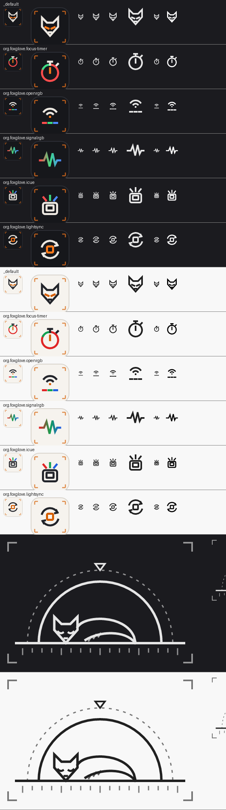

# Plugin icons

Icons for the Plugins tab (the Den) and the tray, plus the tab's empty state. The first-party
sets live in `app/resources/plugins/`, drawn by `scripts/plugin_icons.py`.
`python -I scripts/plugin_icons.py --sheet sheet.png` rewrites them all and renders a review
sheet of every icon on dark and light at the sizes below. The sheet needs `pip install resvg-py`,
the renderer egui itself uses.

## Files per plugin

`app/resources/plugins/<plugin-id>/`, where the folder is the plugin's id from `kit.toml` and
the catalog (`org.foxglove.openrgb`):

| file | what | where the app shows it |
|---|---|---|
| `icon.svg` | 48x48 tile: colour glyph on its own rounded dark square, Bandit corner brackets | catalog cards, the install dialog; dark theme |
| `icon-light.svg` | the same tile on a light square | the same places, light theme (fall back to `icon.svg`) |
| `glyph.svg` | 24x24 monochrome glyph, pure white on transparent | installed-plugin rows, menus, settings headers. Tint it with the theme's text colour (`egui::Image::tint`), so one file serves both themes |
| `tray-white.png`, `tray-black.png` | 32x32 RGBA from the glyph | tray menu entries: white for a dark taskbar, black for a light one, as with `tray-icon-white/black.png` |

`_default/` has the same files (the Bandit fox head), for plugins that ship no icon.
`empty.svg` (240x160, mono white, tint it) is the empty state: shown when no plugins are installed.

## Drawing rules

- **Grid:** 24x24, 2 px strokes, square caps, mitred joins; keep 2 px clear of the edge. In the
  tile the glyph is scaled 1.25x into the middle 30 px.
- **Sizes it must read at:** 16, 20 and 24 px (rows), 32 (tray), 48 and 96 (tile at 1x and 2x).
  One idea per glyph, no text, nothing thinner than the stroke.
- **Colour (tiles only):** line work in the ink colour, one accent. Bandit orange is the accent
  unless colour is the point: red/green/blue for lighting plugins, red/green for the focus timer
  (focus/rest). Palettes are `DARK` and `LIGHT` in the script; light-theme colours are darker so
  they hold contrast on the pale tile.
- **SVG features:** plain shapes, paths, strokes, opacity, linear gradients. No text, fonts,
  filters, masks or external references (egui's resvg loader has no system fonts).
- **No vendor logos.** Vendor plugins get a generic glyph for what they do, not the vendor's
  mark, unless the vendor's brand terms allow it and the grant is recorded in
  [art-licensing.md](art-licensing.md).

## First-party sets

| id | glyph |
|---|---|
| `_default` | the Bandit fox head |
| `org.foxglove.focus-timer` | a timer dial: 25 min focus (red) and 5 min rest (green) of the ring |
| `org.foxglove.openrgb` | broadcast arcs over three colour channels (E1.31 colour in) |
| `org.foxglove.signalrgb` | a waveform in an RGB gradient (another app's lighting signal) |
| `org.foxglove.icue` | colour rays over a keycap (lighting mirrored onto the keyboard) |
| `org.foxglove.lightsync` | two sync arrows round a key |

## Third-party plugins

A plugin may ship `icon.svg` (and optionally `icon-light.svg`, `glyph.svg`) in its package root,
drawn to the rules above. It's a convention, not a `kit.toml` field. The app falls back to
`_default/` when they're missing, and draws a plugin's own icon only after the user approves
the install.

## Credits

Drawn for Foxglove by the project (procedurally, in `scripts/plugin_icons.py`) from the repo
owner's Bandit fox motif. © the repo owner, all rights reserved, like the rest of the Bandit art
(flag F5 in [art-licensing.md](art-licensing.md)). No third-party marks or artwork.
