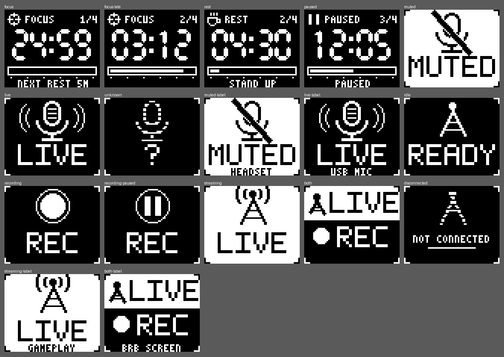

# Plugin screen assets

The keyboard art the first-party plugins draw: left-panel frames and sprites, and an optional
right-screen animation. They live in `assets/plugins/<plugin-id>/` (not under `crates/`,
whose `crates/*` workspace glob would treat an assets-only folder as a crate).
`scripts/plugin_panels.py` draws the panel assets; the right-screen set comes from the Bandit
generator (`art-src/bandit/bandit_art.py`, scenes `Bandit_focus` and `Bandit_onair`, outside this repo) through
`scripts/flipper_art.py`.

## Left panel (`panel.json`)

The panel is the same as the wallpaper art's left-panel spec: 64x52, 1 bit, 416 bytes a frame.
Plugins draw it with `screens.panel_override` ([local-api.md](local-api.md)), which lasts at most
60 s, so a plugin re-sends on each change and before the TTL runs out.

The assets are drawn at 64x52, but a keyboard's info screen can be any size (#560): a plugin asks
`Plugin::panel_target()` (`screens.list`, API 1.4) and sends `PanelTarget::fit()` of its frame,
which is the frame itself at 64x52 and otherwise scaled to fit and centred.

`panel.json` is `"format": "foxglove-panel-assets", "version": 1`. Every sprite is
`{w, h, bitmap}`, with `bitmap` in exactly `panel_override`'s encoding: rows MSB first, each row
padded to whole bytes, 1 = ink, base64. A plugin builds a frame by ORing sprites into a 64x52
buffer at the `layout` positions, or sends a ready-made `frames` entry as it is.
Every file also has `font`, the 3x5 HUD font (4 px per character, A-Z, 0-9 and `' - . : / ? %`).

### Pomodoro (`org.foxglove.focus-timer`)

| key | what |
|---|---|
| `digits` `0`-`9`, `colon` | 11x21 seven-segment digits (3 px strokes), colon 3x21. MM:SS sits at `layout.digits`: digit, +12, colon (1 px gap each side), +12 |
| `icons` `focus`, `rest`, `paused` | 9x9 phase icons: a reticle, a cup, two bars |
| `layout.phase_label` | FOCUS / REST / PAUSED in the 3x5 font, after the icon |
| `layout.round_label` | right-aligned, e.g. `2/4` |
| `layout.bar` | a 60x6 outline; fill the inside (2 px in from the outline) by the phase's progress. Ticks under it at 0, 20 … 100% |
| `layout.hint` | an optional centred line, 15 characters max, e.g. `NEXT REST 5M`, `STAND UP` |

- **Paused:** show the `paused` icon and label, keep the time, and hold the frame. A 1 Hz blink
  of the digits is fine, but don't animate faster.
- **Redraw** once a second while running (only the seconds change, so it's cheap on the link).

`focus.bin` is the right-screen animation (NVA1, 1.8 KiB, 12 frames at 2 fps): the Bandit fox in
the HUD ring, the ring filling like a timer dial, "FOCUS / DO NOT DISTURB". Select it with
`art.select {file}` when a focus phase starts, and put the user's art back afterwards. That needs
`art.write`. #208 suggests leaving the right screen alone by default, so make it an option.

### Mic mute (`org.foxglove.mic-mute`)

`frames` has three whole 64x52 frames, ready to send:

| state | look |
|---|---|
| `muted` | **inverted** (lit background), the mic struck through, MUTED |
| `live` | the mic with sound waves, LIVE |
| `unknown` | a broken-outline mic and `?`: no capture device, or its state couldn't be read |

The inverted MUTED frame is the at-a-glance cue: only MUTED and Broadcast Status's LIVE are
fully bright panels. To
name the device, draw up to 15 characters of `font` centred at `layout.label` (y 47) in the
frame's ink: 0 on `muted`, 1 on the others. Leave it off when there's one microphone.

### Broadcast Status (`org.foxglove.broadcast-status`)

The OBS plugin (#211). Its screens are generic broadcast symbols, not OBS branding. `frames`
has six whole 64x52 frames, ready to send:

| state | when | look |
|---|---|---|
| `idle` | connected, nothing running | the mast, READY |
| `recording` | `RecordStateChanged` active | a filled dot in a ring, REC |
| `recording-paused` | recording paused | pause bars in the ring, REC |
| `streaming` | stream active | **inverted**, the mast with waves, LIVE |
| `both` | recording and streaming | a bright LIVE band on top, the dot and REC below |
| `disconnected` | no connection to the broadcast app (absent, wrong password, reconnecting) | a broken mast, NOT CONNECTED |

- **Label:** the scene name goes at `layout.label` (y 47, up to 15 characters of `font`,
  upper case), in the ink given per state in `layout.label.ink`. In `both`, the label sits on
  the dark half.
- **Brightness:** streaming is the only fully bright state, like MUTED, so "on air" reads at a
  glance.

`onair.bin` is the right-screen animation (NVA1, 4.4 KiB, 8 frames at 4 fps): signal rings pulse
out behind the Bandit fox, and ON AIR flashes its tally lights. Select it with `art.select {file}` while
streaming, as an option (it needs `art.write`).

## Tab icons

`app/resources/plugins/org.foxglove.mic-mute/` (a mic with a red slash) and
`org.foxglove.broadcast-status/` (a mast with waves and a red tally light) add to the existing
icon sets; see [plugin-icons.md](plugin-icons.md).

## Credits

The repo owner's Bandit art, © the owner, all rights reserved, like the other Bandit art (flag F5 in
[art-licensing.md](art-licensing.md)). The MIT licence of the plugin crates doesn't cover it.
