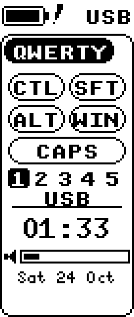
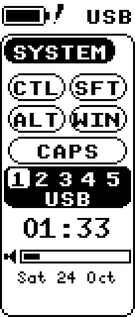
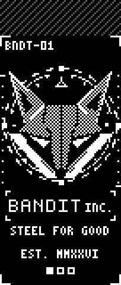

# Foxglove user guide

Foxglove is the software for an Eyelash Corne split keyboard with two small nice!view screens.
It has two parts:

- **The firmware**, which runs on the keyboard itself. It types, holds the layers, and draws both
  screens. All of that works without a PC app.
- **The Foxglove app**, a Windows tray app. It shows which layer you're on, draws a clock and
  media panel on the left screen, picks the art on the right screen, sets the lights, and
  runs plugins.

You can quit the app at any time and the keyboard keeps typing.

## 1. Install the app

1. Download `foxglove-x64.msi` from the
   [Releases page](https://github.com/BanditF/foxglove/releases) (the newest `app-v…` release).
2. Run it. **Windows SmartScreen will warn you**: "Windows protected your PC". The installer
   isn't code-signed yet, so Windows doesn't know it. Click **More info**, then **Run anyway**.
3. Windows asks for administrator permission. Foxglove installs for everyone on the PC,
   into `C:\Program Files\Foxglove`.
4. In the setup screen, **Start with Windows** is off by default. Tick it if you want Foxglove
   running whenever you sign in.

Foxglove then appears in the system tray (the fox icon near the clock; it may be hidden under
the **^** arrow). Right-click it for the menu:

| tray item | what it does |
|---|---|
| status line | which keyboard is connected, if any |
| **Open Foxglove** | opens the Foxglove window |
| **Pause Foxglove** | leaves the keyboard alone until you resume |
| **Profile** | switches between your saved setups (see [Profiles](#profiles)) |
| **Open log folder** | the logs, for a bug report |
| **Quit** | closes Foxglove; the keyboard keeps working |

Updates: Foxglove checks for a new version shortly after it starts, and offers to install it.
**App → Startup and updates** has **Check now** and the option to stop checking.

To uninstall, use **Windows Settings → Apps**. Your settings stay in
`%APPDATA%\Foxglove\config` in case you reinstall; delete that folder to remove them too.

## 2. First connection

The **left half** is the one that talks to the PC. The right half talks only to the left.

1. **Plug the left half in with a USB cable** for the first connection. Foxglove reads the
   keymap over USB once and remembers it.
2. Click **Open Foxglove** in the tray. On the **Keyboard** page, in the **Layer overlay** card
   under **Keymap source**, pick the keyboard in **Device** and click **Connect**. (Keymap source
   hides once the only keyboard found is connected.)
3. To use Bluetooth too, pair it like any Bluetooth keyboard: **Windows Settings → Bluetooth
   & devices → Add device → Bluetooth → Eyelash Corne**. After that, Foxglove works over USB or
   Bluetooth, and reconnects by itself.

On the **Keyboard** page, the **Connection** card says whether you're on USB or Bluetooth, which
Bluetooth slot is active, and which slot belongs to this PC. If unplugging the cable would leave
the keyboard unable to type (it isn't on this PC's Bluetooth slot), it shows a warning. Switch
slot first ([section 6](#6-it-types-on-the-cable-but-not-on-bluetooth)).

## 3. The layers

The keyboard has seven layers. You reach most of them by holding a thumb key.

| layer | how to get there | what's on it |
|---|---|---|
| **QWERTY** | the base layer | letters |
| **NUMBER** | hold the middle left thumb | numbers |
| **SYMBOL** | hold the middle right thumb | symbols |
| **GAME** | tap Backspace + Esc together (again to leave) | a gaming layout |
| **GAME+** | hold the middle left thumb while in GAME | extra gaming keys |
| **FUNCTION** | hold **both** middle thumbs | F1-F12, mouse, media, Print Screen, Caps Lock (A), Insert (Z) |
| **SYSTEM** | hold both middle thumbs, then also hold **Tab** | Bluetooth, USB/Bluetooth output, reset and bootloader keys |

**SYSTEM** keys (keep both thumbs and Tab held while you tap):

| key | does |
|---|---|
| Q W E R T | Bluetooth slot 1-5 (Q is the first) |
| Y / U | send typing over USB / over Bluetooth |
| A | back to QWERTY, and clears any locked layers |
| N S G F | lock NUMBER / SYMBOL / GAME / FUNCTION on or off |
| Left Ctrl | forget the current Bluetooth slot's pairing |
| Esc | **forget all Bluetooth pairings: avoid this one** |
| M (hold 2 s) | turn both halves off; press their reset buttons to wake them |

The full map, including the reset and bootloader keys, is in [layers.md](layers.md).

### Changing a key

Click a key on the layer overlay to open **Edit key**. On a ZMK keyboard each change is on the
keyboard at once, but only until it restarts:
- **Save** (Ctrl+S) keeps your changes; **Discard** goes back to what you last saved. While
  something isn't saved, the window says **Unsaved changes**.
- **Undo** and **Redo** (Ctrl+Z, Ctrl+Y) step through this session's changes.
- Closing the window with unsaved changes asks: **Save**, **Discard** or **Keep editing**.
- **⋯ → Restore stock keymap…** puts back the keymap the firmware was built with, after asking.
- A keyboard built with Studio locking asks you to press its unlock key first (the key your
  keymap gives to `&studio_unlock`). The Corne's firmware has locking off.

## 4. The screens

### Left screen

 

From top to bottom:
- **Battery and connection.** The battery level (with a bolt while charging), and **USB** or
  **BT1-BT5**. A line through the BT number means that slot isn't connected.
- **The layer name**, in the tab.
- **Modifiers.** CTL, SFT, ALT, WIN and CAPS light up while they're held or on.
- **Bluetooth slot boxes, 1-5.** The filled box is the active slot, and an outlined box
  is connected. The word below says what the active one is doing:
  - **USB**: typing goes over the cable.
  - **LINKED**: connected over Bluetooth.
  - **SEARCH**: paired, but the PC isn't in range or is off.
  - **PAIR**: nothing is paired on this slot yet.

  The whole block turns inverted (white) while SYSTEM is held, and for 3 seconds after a
  slot change, so you can see which slot you just picked. This is the quickest way to catch a
  wrong-slot mix-up.
- **The PC panel** at the bottom: the clock, what's playing and the volume. Foxglove draws it.
  If the app closes, the last picture stays. The clock and date follow Windows' region settings
  (Settings › Time & language › Language & region): 12- or 24-hour, the date order and the
  language of day and month names. A change there shows on the panel right away.

### Right screen



The right screen plays an animation. One is built into the firmware, the Bandit emblem ("STEEL
FOR GOOD"), so the screen is never blank before Foxglove sends art; the rest comes from Foxglove
(see **Screens** below), and pieces you keep on the keyboard play without the PC. The strip above
it uses the same icons as the left: the battery (with a bolt while charging), then the link to the
left half: two boxes joined by a bar while the halves are linked, two empty boxes with the bar
broken while they aren't.

Both screens show light ink on a dark field, or dark ink on a light one: **Screens: Dark /
Light** on the Screens page (Showing now) sets both halves, every widget and every piece of art,
and the keyboard keeps the choice. Each picture is turned the right way round when it is made or
sent, so its drawing is the ink; a piece's right-click menu has **Ink: Auto / As is / Invert**
for one Foxglove guessed wrong.

## 5. A tour of the window

Open it from the tray: **Open Foxglove**. The window is called **Foxglove**. At its top right,
on every page, are the **Profile** picker (the profile you're using) and **Copy diagnostics**.
The sidebar has six pages, top to bottom:

- **Keyboard.** The board picture, then:
  - **Firmware:** both halves' versions (a warning appears if they differ), **Refresh** and
    **Update firmware…**.
  - **Key actions:** things the keyboard's own keys can do, as buttons. Risky ones (resets,
    bootloader) need a second click.
  - **Connection:** whether the left half is on USB or Bluetooth, the active Bluetooth slot,
    and this PC's slot.
  - **Batteries:** the batteries of the Bluetooth devices and game controllers connected to this
    PC (a mouse, headphones, a wireless controller), with **Tell me when a device's battery runs
    low** (on by default; one notification below 15% and one below 5%). Devices that don't
    report a battery aren't listed, and the keyboard has its own lines. The tray panel shows the
    same list under **Batteries** when one reports.
  - **Layer overlay:** everything about the picture of the keymap that pops up on screen when
    you change layer, in one card: **When it shows** (how long it stays, the delay before it
    appears), **Appearance** (display, alignment, size, opacity, labels), **Layer colours** (the
    text colour, and per layer its colour and whether it shows), and **Keymap source**, the
    keyboard the overlay reads (**Device**, **Layout**, **Connect**). Keymap source shows only
    when there's a choice: two or more keyboards found, none connected, or more than one layout.
  - **Other keyboards:** read-only support for VIA/QMK keyboards: see
    [Other keyboards](#10-other-keyboards-via).
- **Lights.** **Keyboard** sets the colour, effect, brightness and speed of the keyboard's
  lights. **Follow the Windows accent colour** makes them take Windows' accent colour whenever
  you change it, keeping your brightness. **Lights follow the wallpaper** (off by default) makes
  them take the accent of the wallpaper on screen whenever it changes: a wallpaper that comes
  with a `foxglove.json` palette gives its own accent, any other the Windows accent colour. The
  lights set to **Match keyboard** follow along, and a running scene keeps the lights until it
  ends. These controls need an RGB key in the keymap. The
  same card shows what both halves report now (**Refresh** asks them again) and
  **Calibrate…** for the keyboard. **Other devices** lists the rest of the PC's lights
  ([below](#the-pcs-case-lights-hp-omen-45l)); the keyboard is only in its own card.
- **Scenes.** One effect across every light at once ([below](#scenes-light-that-travels-through-the-room)).
- **Screens.** Both screens and all the right screen's art, from the top:
  - **Showing now:** the left screen and the right screen side by side, each with its name and
    what happens after the keyboard restarts, **‹ Previous** / **Next ›**, and **Rotation**.
    **Change…** under the left screen picks what it shows, with a preview of each: **Clock and
    status** (the keyboard's own), **Clock, media and hints**, **Wallpaper animation**, or **PC load**: CPU, graphics and
    memory use as bars, read from Windows once a second only while it shows, and not while the PC
    is locked or the screen is off. No temperatures: those need a driver.
  - **On the keyboard:** "Kept: 5 of 8 places" and the pieces kept there (they play without
    this PC), then the pieces that **come with the keyboard**. Click one to show it.
  - **On this PC:** every piece on this PC once, with one badge: **ON KEYBOARD**, **THIS PC**,
    **SENDING n%** or **TOO BIG**. Click one to show it until the keyboard restarts;
    **Keep on keyboard** keeps it. **Add art…** adds a file (or a folder of frames).
  - **Left screen:** **On**, **Pause**, what it shows (the clock, media and hints, or the
    wallpaper's animation), how often it redraws, and **App hints**.
  See [Lights and art that go together](#8-lights-and-art-that-go-together).
- **Plugins.** Optional add-ons (Pomodoro, Mic mute, Broadcast Status, OpenRGB): see
  [Plugins](#9-plugins).
- **App.** Foxglove's own preferences:
  - **Profiles:** the setup you're editing (see [Profiles](#profiles) below).
  - **Appearance:** Dark, Light or System.
  - **Startup and updates:** **Start with Windows** and version checks.
  - **Troubleshooting:** **Copy diagnostics**, **Open log folder**, and the connection details
    (what the keyboard said when it connected: host link version, board type, the right half's
    link and battery, the relay and the screens).

### Profiles

A profile is a saved variation of your settings, for example "Game" with a different screen
rate, lights and art. Changes to screens, lights and art go into the profile you're editing.
Anything a profile doesn't change comes from **Default**.

- Switch from the tray (**Profile**), the tray panel, or the **Profile** picker at the window's
  top right. All three show the same profile. An imported profile called "Default" comes in as
  **Default (imported)**, so it can't be mistaken for the built-in Default.
- **Switch profile by program** picks a profile automatically when a given program comes to
  the front.
- **Share profiles** saves them to a file, or loads them from one. The files never include this
  PC's keyboard connection.

Don't confuse these with the keyboard's Bluetooth slots (the 1-5 boxes; ZMK calls them profiles), which are about
which device the keyboard types to.

## 6. It types on the cable but not on Bluetooth

The keyboard is almost always on the wrong Bluetooth slot, the one paired with another device.
Nothing is broken.

1. Look at the slot boxes on the left screen: the filled box is the active slot.
2. Hold both middle thumbs, then hold **Tab** (SYSTEM). Tap the key for this PC's slot:
   **Q** for slot 1, **W** for 2, **E** for 3, **R** for 4, **T** for 5. The block flashes
   inverted to confirm.
3. If you're not sure which slot is this PC's, plug the cable in. **Keyboard → Connection**
   shows "This PC's slot", numbered like the boxes.
4. Typing over the cable but want Bluetooth? SYSTEM + **U**. Back to the cable: SYSTEM + **Y**.

If the PC is missing from every slot, pick an empty one (its word says **PAIR**) and pair
again from Windows' Bluetooth settings. **SYSTEM + Left Ctrl** clears just the current slot
so it can pair fresh. Avoid **SYSTEM + Esc**, which clears every pairing.

If the halves stop talking to each other (the right screen freezes, right-hand keys do
nothing), switch both halves off and on again. If that doesn't help, flash both with the same
firmware ([section 7](#7-updating-the-keyboards-firmware)).

## 7. Updating the keyboard's firmware

Firmware updates come as two files, one per half: `eyelash_corne_studio_left.uf2` for the
left and `nice_view_custom-eyelash_corne_right-zmk.uf2` for the right. Putting the right half's
file on the left half (or the other way round) stops that half working until it's flashed
again, so use the flasher, which checks this for you:

```powershell
python scripts/flash/foxglove_flash.py --firmware C:\path\to\firmware --half both
```

It:
- checks both files before writing anything (the right half, the right size);
- puts each half into its bootloader over the cable, so no button presses are needed with
  recent firmware;
- does the left half first and checks that it types, then does the right;
- reads back the version each half is running.

Every write is logged in `%LOCALAPPDATA%\Foxglove\flash-history.log`. `--dry-run` checks the
files without touching the keyboard. Details and options are in
[scripts/flash/README.md](../scripts/flash/README.md). In this project's agent setup, the
**On-call** session runs the flasher for you once you say go.

By hand, the old way: double-tap a half's reset button and a USB drive appears. Copy that
half's `.uf2` onto it, left half first. The bootloader checks nothing, so be sure which half
you're holding.

## 8. Lights and art that go together

Two labels in this section:
- **after 0.1** means the keyboard needs firmware newer than 0.1;
- **next app update** means the feature is finished but not in the app on `main` yet.

### Lighting presets *(next app update)*

**Lights → Presets** offers seven ready-made looks, each matched to a
Bandit wallpaper family:

| preset | lights | right screen |
|---|---|---|
| Bandit | orange, steady | Bandit Idle |
| Fury | red, slow breathe | FURY Print |
| Constellations | night-sky indigo, breathe | FURY Constellations |
| Hearth | candle amber, breathe | Cauldron Corner |
| Moon Garden | violet, steady | Moon Garden |
| Courier | quiet warm white | Bandit Uplink |
| Signal | rainbow swirl | Bandit Signal |

- **Change the right screen with the preset** (on by default) shows the preset's art too. Pick
  "none" and your own art comes back.
- **Accent colour:** picking a preset turns off **Follow the Windows accent colour**, since the
  two would fight over the colour.
- **Profiles:** each profile can have its own preset, and switching profile switches the look.

### The PC's case lights (HP OMEN 45L)

**Lights → Other devices** lists the lighting devices on this PC and how
Foxglove controls them:
- **Built-in support:** the OMEN 45L case. Pick a colour per zone (diamond display, interior
  light, the three front fans) or one of the swatches for all zones, then **Apply colours**.
  **Identify** blinks the case for a moment; **Off** turns it dark. **Match keyboard** makes
  the case follow the keyboard's light colour you set in Foxglove, or the Windows accent colour when
  the keyboard follows that. Foxglove puts your colours back when the PC starts.
- **Windows lighting**, such as a Logitech G502: Windows' Dynamic Lighting settings
  control it for now.
- **Not controllable yet**, such as the OMEN liquid cooler: listed so you know it was seen.

Each device shows what it can do as small chips, such as **Per-zone RGB · 5 zones**,
**Per-LED RGB · 2 lamps**, or **Screen 160×68 · 1-bit · images & animations**. The controls
follow them: a device with one colour has no zone pickers, and one without lights has none.

**Gear Foxglove doesn't know.** **Add a device…** lists the devices it doesn't recognise. Pick
yours, give it a name, and pick the protocol it speaks if it's one Foxglove knows (or
**Unknown**, which only lists it). Then for each zone, click **Light zone N**, look at the
device, and type what lit up (leave it empty if nothing did). Each zone blinks for a moment
and goes back to how it was (dark if Foxglove never set it). Nothing is sent to the device
until you click. **Save** keeps the entry in `lighting-catalog.local.toml` next to your
settings; **More ▸ → Copy entry** on the device copies it to share, or to send to Foxglove so
everyone gets it, and **More ▸ → Remove…** forgets it (it asks again first).

**Calibrate…** on a device opens the colour calibrator as a dialog over the page. **Save**
keeps your matches; **Cancel**, Escape, leaving the page or closing the window puts the
previous calibration and colours back.

**Retiring OMEN Light Studio.** While Light Studio runs, the page says so: it may put its own
colours back over Foxglove's. Once the case looks right from Foxglove, remove it in
**Settings → Apps → Installed apps → OMEN Light Studio → Uninstall** (or set its
**Background app permissions** to **Never**). Keep **OMEN Command Center**: it runs the fans and
performance modes, not the case lights. The pump's LCD screen is separate and keeps working.

### Scenes: light that travels through the room

**Scenes** (in the sidebar, after Lights) runs one effect across every light at once, so a
scanline can run down the monitors, through the case's fans and on into the keys.
- **Room** shows your monitors, the case, the keyboard and the mouse where Foxglove placed them
  from Windows' display layout, with the scene playing over them. If a device stands somewhere
  else, drag it there; **Reset positions** puts everything back. The line under the map says
  which devices the scene lights: today the case (a colour per zone) and the keyboard (a colour
  per half on firmware with per-LED frames, otherwise one colour for both halves). Others, such
  as a Logitech mouse, are shown only.
- **Check LED map…** (Lights page, Keyboard card; the Scenes page shows it until the map is
  checked): a white dot runs along the keyboard's LEDs on both halves, and the drawing
  shows where Foxglove thinks it is, moving when the keyboard lights each LED (about 0.7 s an
  LED; **Dot speed** makes it slower or faster). Answer **Yes, it matches**, or under
  **Doesn't match?** say how it differs: **Runs backwards**, **Mirrored** (it starts on the
  other side of the half) or **Rows flipped** (it goes up where the drawing goes down); the dot
  runs again on the corrected map, so one to three answers settle it. When the two halves'
  dots run differently, pick **Left half** or **Right half** first and answer for that half
  alone. **None of these…** goes straight to clicking each LED. **Undo** takes an answer back,
  **Run again** restarts the dot; after about a minute the dot stops and the keyboard's own
  lights come back until you run it again. The Eyelash Corne comes with a map (shipped, not
  yet checked on a real one), so scenes use it from the start; a keyboard without one gets a
  guess (down and up each column, then the thumbs), and the button says **Find my LEDs…**.
- **Click each LED** (the dot test's **None of these…**, when the answers can't fix it): Foxglove lights
  one LED at a time in bright white. Click where you see it on the drawing, under a key or between keys; **Can't see
  it** skips one, **Back** lights the one before again, and the count shows how far along you
  are. **Save** at the end, and scenes light every LED where it is (on firmware that takes the
  LEDs' places, the keyboard keeps drawing the scene that way with Foxglove closed too). Cancel (or leaving the
  page) gives the lights back as they were. To check the map again, open **Check LED map…**:
  once saved, the map is yours (a later Foxglove's map for the board doesn't replace it), and
  to start over, **Click each LED…** under **Doesn't match?**.
- **Effect:** Scanline, Sweep, Ripple, Breathe, Gradient or Drift, then its colour (and
  background) or palette, speed, direction and width. Changes show on the map at once, and on
  the lights too while the scene runs.
- **Start** sends the scene to the lights; **Stop** puts back the colours from before (or the
  ones you picked for the keyboard or the case meanwhile). A plugin's notification still shows
  over a scene, and nothing is sent while the PC is locked, the display is off or Foxglove is
  paused.
- **Presets:** pick one to load its look. To keep your own, type a name under **Save as
  preset** and click **Save**; **Remove** deletes one of yours.
- **Wallpapers:** when a Wallpaper Engine wallpaper on your PC comes with looks for Foxglove
  (a `foxglove.json` in its folder, such as the Bandit wallpapers), its looks show first under
  **Wallpapers**, in its own colours. They work with any wallpaper on screen, or none. The one
  Wallpaper Engine shows now says **On screen**. Tick **Right screen too** and, while one of
  them runs, the right screen shows that wallpaper's art; Stop puts your art back. A wallpaper
  that follows Foxglove gets the scene's clock as soon as the scene starts or its look changes.
  With no such wallpaper, the group isn't there.

- **Triggers** (under Effect, each for the profile you are in):
  - **Start with this profile:** switching to this profile starts its scene, and switching to a
    profile without the box stops it again, unless you pressed Start yourself. With program
    rules (Settings, Profile, "Switch profile by program") a game can bring its own scene. On
    Base settings it starts the scene when Foxglove starts.
  - **Ripple on key press:** each key you press sends one ring of the scene's colour out from
    that key. Foxglove only learns where the key is, never what it types.
  - **Sweep on layer change:** changing layer sends one sweep across the room in that layer's
    overlay colour.
  - Ripples and sweeps show only while a scene runs.

Each profile keeps its own scene, so switching to Game can bring a different look; your saved
presets are the same in every profile.

### Cycling the right screen's art

**Screens → Showing now → Rotation** steps through what the keyboard holds: the piece that
comes with it (the Bandit emblem), then the ones you kept on it. With nothing kept, **Next ›**
from a piece sent from this PC shows the emblem, and from the emblem there is nothing else to
show. There is no separate list: to change what Rotation
shows, keep or remove pieces on the keyboard. (A playlist of art that only this PC has is a
later idea, #522.)
- **Next piece** comes on any of these, in any mix:
  - **on the art key** *(after 0.1, next app update)*: hold SYSTEM (both middle thumbs + Tab),
    then **P** for next and **O** for previous. Without the app, the keyboard steps through its
    own built-ins and saved slots. *(next app update)* The left screen shows **ART 3/7** and the
    name for a second.
  - **Lights wake**: the next piece each time the keyboard's lights come back on.
  - **every N minutes**.
- **Wallpaper:** the right screen shows the art that goes with the wallpaper on
  screen. It works best with Wallpaper Engine, found in any Steam library. Without it, or while
  it isn't running, your Windows desktop wallpaper counts: name the image after a wallpaper in
  the art folder's `wallpapers.json` (for example `fury-stars.png`). If Wallpaper Engine is
  installed somewhere Steam doesn't know, set `FOXGLOVE_WALLPAPER_ENGINE_DIR` to its folder.
  Press **Refresh** after installing or moving it.
- **Layer art:** give a layer its own art, for example Bandit Radar for GAME. It shows while you
  hold the layer (after 0.4 s, so a quick tap doesn't flash it), then the art before comes back.
- **Priority:** your own pick (or an art-key press) wins, then layer art, then preset art, then
  the wallpaper, then Rotation.

### Keeping art on the keyboard

The right half keeps up to 8 pieces of your own, and they play without this PC. **Screens → On
the keyboard** shows how full it is ("Kept: 5 of 8 places") and what each place holds.
- **Show a piece from this PC:** click it under **On this PC**. It shows until the keyboard
  restarts (the badge says **SHOWING UNTIL RESTART**); Foxglove sends it again after a restart
  while it runs.
- **Keep on keyboard:** one click on the piece (or under **Showing now**). Foxglove sends it,
  keeps it in a free place and shows it from there. When all places are full, it asks which
  piece to replace, says whether this PC still has a copy of it and whether a layer uses it, or
  offers **Just show it for now**.
- **Remove from keyboard:** right-click a kept piece. It asks first, and warns when this PC has
  no copy (the keyboard can't send a piece back).
- **Use instead of…** (right-click a kept piece): it shows wherever a built-in is chosen, in
  layer art and presets. The firmware itself doesn't change.
- **Add art… → A folder of frames…** adds folders of `frame_N.png` + `meta.txt` sets (like
  `art-src\bandit\out`); each set shows under **On this PC** and is converted when you show or
  keep it.
- **The strip** under Showing now (and in the tray) says what is being sent, how it ended, and
  what to do when something goes wrong, for example "The right half is asleep. Press any key on
  it, then: Try again".
- **After a firmware update** the keyboard card says what happened to the art: whether your kept
  pieces are still there, and which pieces came or went with the new firmware. A built-in you
  picked follows its name, not its number, so it stays the same picture.
- **The tray panel's Screens part** shows the left screen's line with **Pause**, the right
  screen's piece and badge, **‹** / **Next ›** through Rotation, **Art…** (opens Screens) and
  the same strip. Adding files happens on the Screens page.

## 9. Plugins

**The Plugins page.** Each plugin runs as its own small program with only the permissions you
approve when you install it. Only signed plugins run.
- **Installing:** the catalog lists the first-party plugins as "Coming soon" until they're
  published. For now a plugin installs from its file (**Install from file…**), which shows
  exactly what it may do first.
- **Managing:** each installed plugin has an on/off switch, **Remove** (two clicks), its status
  (running / restarting / stopped), its permissions, and **Options** for its own settings.
- **Keys for a plugin:** a plugin's actions (pause the timer, mute the mic) each get a key from
  **F13–F24**. Put that key on your keymap in ZMK Studio or VIA. It types nothing, and Foxglove
  passes it to the plugin. A key that another program already holds is flagged.

| plugin | what it does | you set up |
|---|---|---|
| **Pomodoro** | focus and rest periods; a big countdown on the left screen; red / green lights; a long rest every four rounds | keys for **Pause or resume** and **Start a new focus period** |
| **Mic mute** | MUTED (bright) / LIVE / ? on the left screen, red when muted; mutes Windows' default communications mic | keys for **toggle**, **mute**, **unmute**. Apps can still mute themselves separately |
| **Broadcast Status** | OBS: READY / REC / LIVE and the scene name on the left, red on the keyboard while live; it only listens | in OBS, **Tools → WebSocket Server Settings** (port 4455); paste its password into the plugin's settings (kept in Windows' credential store) |
| **OpenRGB (E1.31)** | OpenRGB colours your keyboard | in OpenRGB, add an E1.31 device at 127.0.0.1, universe 1. It listens on this PC only (UDP 5568) |
| **SignalRGB** | SignalRGB lights the keyboard with the rest of your setup | coming soon; listed in the catalog |

While a plugin's frame is on the left screen, it's in charge of it. Foxglove's own clock comes
back when the plugin lets go, or at the latest after a minute.

## 10. Other keyboards (VIA)

**Keyboard → Other keyboards** shows QMK keyboards with VIA (like a Keychron K5 Pro) in
the overlay, over USB. Foxglove only **reads** them: their keymap, layers and lights. It never
changes them.
- **Setup:** tick **Use VIA keyboards** and add the keyboard's VIA definition (the JSON from its
  maker) with **Add VIA definition (JSON)…**.
- **Let other apps use it** closes Foxglove's connection to it, so VIA or the maker's
  app can use it without two programs talking at once. **Resume** connects again.
- **Active layer:** stock firmware doesn't report it, so it shows as unknown.
- **The same keyboard on another port:** Foxglove asks whether it's the one you used before.

## 11. If something goes wrong

The keyboard types without the app, so first quit Foxglove (tray icon → **Quit**) and check
that typing works. Then find your case below.

### The left half stops typing after an update

1. Double-tap the left half's reset button. A USB drive appears.
2. Copy the release's **left** file, `eyelash_corne_studio_left.uf2`, onto it. The half restarts
   by itself.
3. Check that it types over the cable before you touch the right half.

### The right half doesn't talk (right screen frozen, right-hand keys dead)

1. Switch both halves off and on again.
2. Still dead: flash the right half again with the same release as the left
   ([section 7](#7-updating-the-keyboards-firmware)).

### Last resort: reset the saved settings

This wipes the halves' saved settings and every Bluetooth pairing.

1. Double-tap a half's reset button and copy `settings_reset-nice_nano_v2-zmk.uf2` from the
   firmware release onto the drive. Do the same for the other half.
2. Flash each half's normal file again, left first. The halves find each other on their own.
3. Pair the keyboard with Windows again (Settings → Bluetooth & devices → Add device →
   "Eyelash Corne"), on slot 1 ([section 6](#6-it-types-on-the-cable-but-not-on-bluetooth)).

### The keyboard went dark and won't wake (soft off)

**SYSTEM + M**, held for 2 seconds, switches both halves off. Keys can't wake them.

1. Press each half's reset button once (once, not twice, or you get the USB drive).

### When the keyboard's lights go dark on their own

- **On USB power** (the cable in): the lights stay on while the PC is awake, with Foxglove
  running. They go dark when the PC's screen turns off or the PC sleeps, and come back when the
  screen comes on or you unlock. Locking alone keeps them on. With Foxglove closed they stay on
  for 10 minutes after your last key.
- **On battery:** they go dark 30 seconds after your last key, and the half sleeps after 30
  minutes. A key wakes it.
- **The right half** keeps its battery rules while only the left is plugged in: it goes dark on
  its own to save its battery. Plug it in too to keep it lit.

### The lights stay stuck after Foxglove closes

A plugin or Foxglove set the colour and nothing changed it back.

1. Open Foxglove again and set the colour on the **Lights** page.
2. Or set them from the keyboard: hold the middle left thumb (NUMBER), then **X** on, **Z** off,
   **B** next effect, **comma** / **period** brighter or dimmer.

### The screen flickers black, or the PC is slow after sleep

On this kind of PC, the NVIDIA graphics driver sometimes resets (Windows logs "display driver
stopped responding"). It also misbehaves while the screen is off in Modern Standby. Foxglove
notices a reset and starts a fresh copy of itself, at most 3 times in 10 minutes. If the PC is
sluggish after sleep:

1. Update the NVIDIA driver and the NVIDIA app, and turn off the NVIDIA overlay.
2. If it's still slow, restart the PC. Restarting Foxglove alone doesn't fix it, since the
   problem is outside the app.

### Reporting a problem

1. Open Foxglove's settings and click **Copy diagnostics** at the top right. It copies the app
   and firmware versions, the connection, plugins, Windows and the graphics card, and the last
   200 log lines. Your user name, PC name and passwords are left out.
2. Paste it into the issue or message.
3. The full log is in `%APPDATA%\Foxglove\logs\foxglove.log` (**App → Troubleshooting → Open log folder**, or the tray menu's **Open log folder**).

## Where things are kept

| what | where |
|---|---|
| Foxglove's settings, profiles, hotlist, presets, plugin settings | `%APPDATA%\Foxglove\foxglove.toml` (one file; older `*.ini` files are imported once and renamed `*.migrated`) |
| the overlay's own settings (KeyPeek's) | `%APPDATA%\Foxglove\config\settings.ini` |
| keymap cache | `%APPDATA%\Foxglove\config\keymap-*.studio` |
| art library (pushed animations, wallpaper art, converted source sets) | `%APPDATA%\Foxglove\config\art\` |
| installed plugins | `%APPDATA%\Foxglove\plugins\` |
| plugin passwords and tokens | Windows Credential Manager (`Foxglove/plugin/<id>/<name>`), never in a file |
| updates downloaded | `%LOCALAPPDATA%\Foxglove\updates\` |
| firmware flash history | `%LOCALAPPDATA%\Foxglove\flash-history.log` |
| Foxglove's log (two files, about 2 MB at most) | `%APPDATA%\Foxglove\logs\foxglove.log` and `foxglove.1.log` |

To try things without touching your real settings, start Foxglove with `FOXGLOVE_CONFIG_DIR`
set to another folder: every settings file goes there instead.
