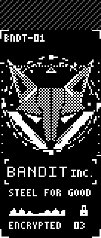

# Foxglove user guide

Foxglove is the software for an Eyelash Corne split keyboard with two small nice!view screens.
It has two parts:

- **The firmware**, which runs on the keyboard itself. It types, holds the layers, and draws both
  screens. All of that works without a PC app.
- **The Foxglove app**, a Windows tray app. It shows which layer you're on, draws a clock and
  media panel on the left screen, picks the art on the right screen, sets the lights, and
  runs plugins.

You can quit the app at any time and the keyboard keeps typing.

## 1. Install the app

1. Download `foxglove-x64.msi` from the
   [Releases page](https://github.com/BanditF/foxglove/releases) (the newest `app-v…` release).
2. Run it. **Windows SmartScreen will warn you**: "Windows protected your PC". The installer
   isn't code-signed yet, so Windows doesn't know it. Click **More info**, then **Run anyway**.
3. Windows asks for administrator permission. Foxglove installs for everyone on the PC,
   into `C:\Program Files\Foxglove`.
4. In the setup screen, **Start with Windows** is off by default. Tick it if you want Foxglove
   running whenever you sign in.

Foxglove then appears in the system tray (the fox icon near the clock; it may be hidden under
the **^** arrow). Right-click it for the menu:

| tray item | what it does |
|---|---|
| status line | which keyboard is connected, if any |
| **Settings...** | opens the settings window |
| **Pause left panel** | freezes the PC panel on the left screen |
| **Right art** | picks the right screen's animation |
| **Profile** | switches between your saved setups (see [Profiles](#profiles)) |
| **Quit** | closes Foxglove; the keyboard keeps working |

Updates: Foxglove checks for a new version shortly after it starts, and offers to install it.
**Settings → Updates** has **Check now** and the option to stop checking.

To uninstall, use **Windows Settings → Apps**. Your settings stay in
`%APPDATA%\Foxglove\config` in case you reinstall; delete that folder to remove them too.

## 2. First connection

The **left half** is the one that talks to the PC. The right half talks only to the left.

1. **Plug the left half in with a USB cable** for the first connection. Foxglove reads the
   keymap over USB once and remembers it.
2. Open **Settings...** from the tray. Under **Connection**, pick the keyboard in **Device**
   and click **Connect**.
3. To use Bluetooth too, pair it like any Bluetooth keyboard: **Windows Settings → Bluetooth
   & devices → Add device → Bluetooth → Eyelash Corne**. After that, Foxglove works over USB or
   Bluetooth, and reconnects by itself.

Under **Keyboard** in Settings, the **Connection** line says whether you're on USB or Bluetooth,
which Bluetooth profile is active, and which profile belongs to this PC. If unplugging the cable
would leave the keyboard unable to type (it isn't on this PC's Bluetooth profile), it shows a
warning. Switch profile first ([section 6](#6-it-types-on-the-cable-but-not-on-bluetooth)).

## 3. The layers

The keyboard has seven layers. You reach most of them by holding a thumb key.

| layer | how to get there | what's on it |
|---|---|---|
| **QWERTY** | the base layer | letters |
| **NUMBER** | hold the middle left thumb | numbers |
| **SYMBOL** | hold the middle right thumb | symbols |
| **GAME** | tap Backspace + Esc together (again to leave) | a gaming layout |
| **GAME+** | hold the middle left thumb while in GAME | extra gaming keys |
| **FUNCTION** | hold **both** middle thumbs | F1-F12, mouse, media, Print Screen, Caps Lock (A), Insert (Z) |
| **SYSTEM** | hold both middle thumbs, then also hold **Tab** | Bluetooth, USB/Bluetooth output, reset and bootloader keys |

**SYSTEM** keys (keep both thumbs and Tab held while you tap):

| key | does |
|---|---|
| Q W E R T | Bluetooth profile 1-5 (Q is the first) |
| Y / U | send typing over USB / over Bluetooth |
| A | back to QWERTY, and clears any locked layers |
| N S G F | lock NUMBER / SYMBOL / GAME / FUNCTION on or off |
| Left Ctrl | forget the current Bluetooth profile's pairing |
| Esc | **forget all Bluetooth pairings: avoid this one** |
| M (hold 2 s) | turn both halves off; press their reset buttons to wake them |

The full map, including the reset and bootloader keys, is in [layers.md](layers.md).

## 4. The screens

### Left screen

 

From top to bottom:
- **Battery and connection.** The battery level (with a bolt while charging), and **USB** or
  **BT1-BT5**. A line through the BT number means that profile isn't connected.
- **The layer name**, in the tab.
- **Modifiers.** CTL, SFT, ALT, WIN and CAPS light up while they're held or on.
- **Bluetooth profile boxes, 1-5.** The filled box is the active profile, and an outlined box
  is connected. The word below says what the active one is doing:
  - **USB**: typing goes over the cable.
  - **LINKED**: connected over Bluetooth.
  - **SEARCH**: paired, but the PC isn't in range or is off.
  - **PAIR**: nothing is paired on this profile yet.

  The whole block turns inverted (white) while SYSTEM is held, and for 3 seconds after a
  profile change, so you can see which profile you just picked. This is the quickest way to
  catch a wrong-profile mix-up.
- **The PC panel** at the bottom: the clock, what's playing and the volume. Foxglove draws it.
  If the app closes, the last picture stays. The clock and date follow Windows' region settings
  (Settings › Time & language › Language & region): 12- or 24-hour, the date order and the
  language of day and month names. A change there shows on the panel right away.

### Right screen



The right screen plays an animation. Several are built into the firmware, and Foxglove can send
others (see **Right screen art** below). The battery and connection strip sits above it.

## 5. Settings tour

Open it from the tray: **Settings...**. From the top:

- **Connection, Overlay Appearance, Theme.** The layer overlay: a picture of the keymap that
  pops up on screen when you change layer. You can pick its monitor, size, colours, which layers
  show it, and how long it stays.
- **Profile.** The setup you're editing (see [Profiles](#profiles) below).
- **Updates.** Version checks.
- **Keyboard.** The connection line, both halves' firmware versions (a warning appears if they
  differ), and:
  - **Lights.** Colour, effect, brightness and speed of the underglow on each half.
    **Follow the Windows accent colour** makes the lights take Windows' accent colour
    whenever you change it, keeping your brightness. These controls need an RGB key in the
    keymap.
  - **Actions.** Things the keyboard's own keys can do, as buttons. Risky ones (resets,
    bootloader) need a second click.
- **Screens.** The left screen's PC panel:
  - **Drive left screen** turns the panel on or off, and **Pause** freezes it.
  - **frames per second** sets how often it redraws.
  - **Show** picks the clock, media and hints, or the current Wallpaper Engine wallpaper's
    animation.
  - **Game hints** show a short note while a given program is in front.
  - The panel status shows the right half's link and battery.
- **Right screen art.** What plays on the right:
  - choose a built-in animation, or push one from a file;
  - **Saved on the keyboard** keeps a pushed animation on the keyboard itself;
  - **Hotlist** and **Art library…**: see [Lights and art that go together](#8-lights-and-art-that-go-together).
- **Other keyboards (VIA).** Read-only support for VIA/QMK keyboards: see
  [Other keyboards](#10-other-keyboards-via).
- **Plugins.** Optional add-ons (Pomodoro, Mic mute, Broadcast Status, OpenRGB): see
  [Plugins](#9-plugins).

### Profiles

A profile is a saved variation of your settings, for example "Game" with a different screen
rate, lights and art. Changes to screens, lights and art go into the profile you're editing.
Anything a profile doesn't change comes from **Base settings**.

- Switch from the tray (**Profile**) or the **Profile** box at the top of Settings.
- **Switch profile by program** picks a profile automatically when a given program comes to
  the front.
- **Share profiles** saves them to a file, or loads them from one. The files never include this
  PC's keyboard connection.

Don't confuse these with the keyboard's Bluetooth profiles (the 1-5 boxes), which are about
which device the keyboard types to.

## 6. It types on the cable but not on Bluetooth

The keyboard is almost always on the wrong Bluetooth profile, the one paired with another
device. Nothing is broken.

1. Look at the profile boxes on the left screen: the filled box is the active profile.
2. Hold both middle thumbs, then hold **Tab** (SYSTEM). Tap the key for this PC's profile:
   **Q** for profile 1, **W** for 2, **E** for 3, **R** for 4, **T** for 5. The block flashes
   inverted to confirm.
3. If you're not sure which profile is this PC's, plug the cable in. **Settings → Keyboard**
   shows "this PC: profile N", numbered like the boxes.
4. Typing over the cable but want Bluetooth? SYSTEM + **U**. Back to the cable: SYSTEM + **Y**.

If the PC is missing from every profile, pick an empty one (its word says **PAIR**) and pair
again from Windows' Bluetooth settings. **SYSTEM + Left Ctrl** clears just the current profile
so it can pair fresh. Avoid **SYSTEM + Esc**, which clears every pairing.

If the halves stop talking to each other (the right screen freezes, right-hand keys do
nothing), switch both halves off and on again. If that doesn't help, flash both with the same
firmware ([section 7](#7-updating-the-keyboards-firmware)).

## 7. Updating the keyboard's firmware

Firmware updates come as two files, one per half: `eyelash_corne_studio_left.uf2` for the
left and `nice_view_custom-eyelash_corne_right-zmk.uf2` for the right. Putting the right half's
file on the left half (or the other way round) stops that half working until it's flashed
again, so use the flasher, which checks this for you:

```powershell
python scripts/flash/foxglove_flash.py --firmware C:\path\to\firmware --half both
```

It:
- checks both files before writing anything (the right half, the right size);
- puts each half into its bootloader over the cable, so no button presses are needed with
  recent firmware;
- does the left half first and checks that it types, then does the right;
- reads back the version each half is running.

Every write is logged in `%LOCALAPPDATA%\Foxglove\flash-history.log`. `--dry-run` checks the
files without touching the keyboard. Details and options are in
[scripts/flash/README.md](../scripts/flash/README.md). In this project's agent setup, the
**On-call** session runs the flasher for you once you say go.

By hand, the old way: double-tap a half's reset button and a USB drive appears. Copy that
half's `.uf2` onto it, left half first. The bootloader checks nothing, so be sure which half
you're holding.

## 8. Lights and art that go together

Two labels in this section:
- **after 0.1** means the keyboard needs firmware newer than 0.1;
- **next app update** means the feature is finished but not in the app on `main` yet.

### Lighting presets *(next app update)*

**Settings → Keyboard → Lights → Preset** offers seven ready-made looks, each matched to a
Bandit wallpaper family:

| preset | lights | right screen |
|---|---|---|
| Bandit | orange, steady | Bandit Idle |
| Fury | red, slow breathe | FURY Print |
| Constellations | night-sky indigo, breathe | FURY Constellations |
| Hearth | candle amber, breathe | Cauldron Corner |
| Moon Garden | violet, steady | Moon Garden |
| Courier | quiet warm white | Bandit Uplink |
| Signal | rainbow swirl | Bandit Signal |

- **Change the right screen with the preset** (on by default) shows the preset's art too. Pick
  "none" and your own art comes back.
- **Accent colour:** picking a preset turns off **Follow the Windows accent colour**, since the
  two would fight over the colour.
- **Profiles:** each profile can have its own preset, and switching profile switches the look.

### The PC's case lights (HP OMEN 45L)

**Settings → Lights → PC & peripherals** lists the lighting devices on this PC and how
Foxglove controls them:
- **Foxglove driver:** the OMEN 45L case. Pick a colour per zone (diamond display, interior
  light, the three front fans) or one of the swatches for all zones, then **Apply colours**.
  **Identify** blinks the case for a moment; **Off** turns it dark. **Match keyboard** makes
  the case follow the underglow colour you set in Foxglove, or the Windows accent colour when
  the keyboard follows that. Foxglove puts your colours back when the PC starts.
- **Standard LampArray device**, such as a Logitech G502: Windows' Dynamic Lighting settings
  control it for now.
- **Not controllable yet**, such as the OMEN liquid cooler: listed so you know it was seen.

Each device shows what it can do as small chips, such as **Per-zone RGB · 5 zones**,
**Per-LED RGB · 2 lamps**, or **Screen 160×68 · 1-bit · images & animations**. The controls
follow them: a device with one colour has no zone pickers, and one without lights has none.

**Gear Foxglove doesn't know.** **Add a device…** lists the devices it doesn't recognise. Pick
yours, give it a name, and pick the protocol it speaks if it's one Foxglove knows (or
**Unknown**, which only lists it). Then for each zone, click **Light zone N**, look at the
device, and type what lit up (leave it empty if nothing did). Each zone blinks for a moment
and goes back to how it was (dark if Foxglove never set it). Nothing is sent to the device
until you click. **Save** keeps the entry in `lighting-catalog.local.toml` next to your
settings; **Copy entry** on the device copies it to share, or to send to Foxglove so everyone
gets it.

**Retiring OMEN Light Studio.** While Light Studio runs, the page says so: it may put its own
colours back over Foxglove's. Once the case looks right from Foxglove, remove it in
**Settings → Apps → Installed apps → OMEN Light Studio → Uninstall** (or set its
**Background app permissions** to **Never**). Keep **OMEN Command Center**: it runs the fans and
performance modes, not the case lights. The pump's LCD screen is separate and keeps working.

### Cycling the right screen's art

**Settings → Right screen art → Hotlist** is your list of favourites.
- **Next entry** steps the list on any of these, in any mix:
  - **on the art key** *(after 0.1, next app update)*: hold SYSTEM (both middle thumbs + Tab),
    then **P** for next and **O** for previous. Without the app, the keyboard steps through its
    own built-ins and saved slots. *(next app update)* The left screen shows **ART 3/7** and the
    name for a second.
  - **when the lights wake**: the next entry each time the underglow comes back on.
  - **every N minutes**.
- **Follow the wallpaper:** with Wallpaper Engine, the right screen shows the art that goes with
  the wallpaper on screen.
- **Layer art:** give a layer its own art, for example Bandit Radar for GAME. It shows while you
  hold the layer (after 0.4 s, so a quick tap doesn't flash it), then the art before comes back.
- **Priority:** your own pick (or an art-key press) wins, then layer art, then preset art, then
  the wallpaper, then the hotlist.

### The art library

**Settings → Right screen art → Art library…** opens one grid of every animation Foxglove
knows: the keyboard's built-ins, what's saved on it, your library folder, the sets that come with
the app, and your source folders. The same art in two places shows once.
- **Each card shows:**
  - whether it's **on screen**;
  - where it lives (built-in, saved slot, library, bundled, source);
  - whether it's pinned, in the hotlist, or a layer's art;
  - its size; anything over 16 KiB is too big to send.
- **Actions:**
  - **Show** shows it now (built-ins and slots at once; files are sent over);
  - ☆ adds it to the hotlist;
  - **Clear slot** frees a saved slot (two clicks);
  - **Recycle** moves a library file to the Recycle Bin.
- **Stand in for…** (on a saved slot): the slot replaces a built-in everywhere that names it,
  in the hotlist, layer art and presets. The built-in's card says "replaced by slot N" and
  has **Undo stand-in**. The firmware itself doesn't change.
- **Source folders:** add folders of `frame_N.png` + `meta.txt` sets (like `art-src\bandit\out`).
  Each set shows with a thumbnail, and **Show** or **Add to library** converts it in the app.

## 9. Plugins

**Settings → Plugins.** Each plugin runs as its own small program with only the permissions you
approve when you install it. Only signed plugins run.
- **Installing:** the catalog lists the first-party plugins as "Coming soon" until they're
  published. For now a plugin installs from its file (**Install from file…**), which shows
  exactly what it may do first.
- **Managing:** each installed plugin has an on/off switch, **Remove** (two clicks), its status
  (running / restarting / stopped), its permissions, and its own settings.
- **Keys for a plugin:** a plugin's actions (pause the timer, mute the mic) each get a key from
  **F13–F24**. Put that key on your keymap in ZMK Studio or VIA. It types nothing, and Foxglove
  passes it to the plugin. A key that another program already holds is flagged.

| plugin | what it does | you set up |
|---|---|---|
| **Pomodoro** | focus and rest periods; a big countdown on the left screen; red / green lights; a long rest every four rounds | keys for **Pause or resume** and **Start a new focus period** |
| **Mic mute** | MUTED (bright) / LIVE / ? on the left screen, red when muted; mutes Windows' default communications mic | keys for **toggle**, **mute**, **unmute**. Apps can still mute themselves separately |
| **Broadcast Status** | OBS: READY / REC / LIVE and the scene name on the left, red on the keyboard while live; it only listens | in OBS, **Tools → WebSocket Server Settings** (port 4455); paste its password into the plugin's settings (kept in Windows' credential store) |
| **OpenRGB (E1.31)** | OpenRGB colours your keyboard | in OpenRGB, add an E1.31 device at 127.0.0.1, universe 1. It listens on this PC only (UDP 5568) |
| **SignalRGB** | SignalRGB lights the keyboard with the rest of your setup | coming soon; listed in the catalog |

While a plugin's frame is on the left screen, it's in charge of it. Foxglove's own clock comes
back when the plugin lets go, or at the latest after a minute.

## 10. Other keyboards (VIA)

**Settings → Other keyboards (VIA)** shows QMK keyboards with VIA (like a Keychron K5 Pro) in
the overlay, over USB. Foxglove only **reads** them: their keymap, layers and lights. It never
changes them.
- **Setup:** tick **Use VIA keyboards** and add the keyboard's VIA definition (the JSON from its
  maker) with **Add VIA definition (JSON)…**.
- **Pause Foxglove for this keyboard** closes Foxglove's connection to it, so VIA or the maker's
  app can use it without two programs talking at once. **Resume** connects again.
- **Active layer:** stock firmware doesn't report it, so it shows as unknown.
- **The same keyboard on another port:** Foxglove asks whether it's the one you used before.

## 11. If something goes wrong

The keyboard types without the app, so first quit Foxglove (tray icon → **Quit**) and check
that typing works. Then find your case below.

### The left half stops typing after an update

1. Double-tap the left half's reset button. A USB drive appears.
2. Copy the release's **left** file, `eyelash_corne_studio_left.uf2`, onto it. The half restarts
   by itself.
3. Check that it types over the cable before you touch the right half.

### The right half doesn't talk (right screen frozen, right-hand keys dead)

1. Switch both halves off and on again.
2. Still dead: flash the right half again with the same release as the left
   ([section 7](#7-updating-the-keyboards-firmware)).

### Last resort: reset the saved settings

This wipes the halves' saved settings and every Bluetooth pairing.

1. Double-tap a half's reset button and copy `settings_reset-nice_nano_v2-zmk.uf2` from the
   firmware release onto the drive. Do the same for the other half.
2. Flash each half's normal file again, left first. The halves find each other on their own.
3. Pair the keyboard with Windows again (Settings → Bluetooth & devices → Add device →
   "Eyelash Corne"), on profile 1 ([section 6](#6-it-types-on-the-cable-but-not-on-bluetooth)).

### The keyboard went dark and won't wake (soft off)

**SYSTEM + M**, held for 2 seconds, switches both halves off. Keys can't wake them.

1. Press each half's reset button once (once, not twice, or you get the USB drive).

### The lights stay stuck after Foxglove closes

A plugin or Foxglove set the colour and nothing changed it back.

1. Open Foxglove again and set the colour on the **Lights** page.
2. Or set them from the keyboard: hold the middle left thumb (NUMBER), then **X** on, **Z** off,
   **B** next effect, **comma** / **period** brighter or dimmer.

### The screen flickers black, or the PC is slow after sleep

On this kind of PC, the NVIDIA graphics driver sometimes resets (Windows logs "display driver
stopped responding"). It also misbehaves while the screen is off in Modern Standby. Foxglove
notices a reset and starts a fresh copy of itself, at most 3 times in 10 minutes. If the PC is
sluggish after sleep:

1. Update the NVIDIA driver and the NVIDIA app, and turn off the NVIDIA overlay.
2. If it's still slow, restart the PC. Restarting Foxglove alone doesn't fix it, since the
   problem is outside the app.

### Reporting a problem

1. Open Foxglove's settings and click **Copy diagnostics** at the top right. It copies the app
   and firmware versions, the connection, plugins, Windows and the graphics card, and the last
   200 log lines. Your user name, PC name and passwords are left out.
2. Paste it into the issue or message.
3. The full log is in `%APPDATA%\Foxglove\logs\foxglove.log` (tray menu → **Open log folder**).

## Where things are kept

| what | where |
|---|---|
| Foxglove's settings, profiles, hotlist, presets, plugin settings | `%APPDATA%\Foxglove\foxglove.toml` (one file; older `*.ini` files are imported once and renamed `*.migrated`) |
| the overlay's own settings (KeyPeek's) | `%APPDATA%\Foxglove\config\settings.ini` |
| keymap cache | `%APPDATA%\Foxglove\config\keymap-*.studio` |
| art library (pushed animations, wallpaper art, converted source sets) | `%APPDATA%\Foxglove\config\art\` |
| installed plugins | `%APPDATA%\Foxglove\plugins\` |
| plugin passwords and tokens | Windows Credential Manager (`Foxglove/plugin/<id>/<name>`), never in a file |
| updates downloaded | `%LOCALAPPDATA%\Foxglove\updates\` |
| firmware flash history | `%LOCALAPPDATA%\Foxglove\flash-history.log` |
| Foxglove's log (two files, about 2 MB at most) | `%APPDATA%\Foxglove\logs\foxglove.log` and `foxglove.1.log` |

To try things without touching your real settings, start Foxglove with `FOXGLOVE_CONFIG_DIR`
set to another folder: every settings file goes there instead.
